# Rare Disease Atlas: JAK-STAT MVP

Hack-Nation 7th Global AI Hackathon, Challenge 05: *AI Atlas for the World's Rare Diseases* (OpenAI x Buffalo Initiative).

> **Research navigation, not medical advice.** No dosing information appears anywhere in this project. Outreach drafts are drafts; nothing is ever sent.

**Deadline:** 9:00 AM ET, Sun Oct 4 2026. **Internal submit target:** 8:30 AM ET.
**Deliverables (per the brief):**
- **Working prototype**, deployed (or easy to run locally) so judges can search and explore it live. We deploy it and check it works while logged out.
- **Source code repository** with a README covering the architecture and how to reproduce the dataset (this file).
- **A team video and a 1-minute walkthrough.** The walkthrough follows a family or patient group through the graph to either a justified collaboration and next step, or an honest gap with a plan to investigate it. Our walkthrough is Maria's journey (Section 11). The team records both.

**Brief:** *Challenge 05: AI Atlas for the World's Rare Diseases* (Hack-Nation × OpenAI × Buffalo Initiative). Section 15 maps each brief requirement to where this plan covers it.

> **Status: graph v1 built** (`data/build/build_report.json` → `built_at` 2026-10-04T04:17:54Z, offline replay of the caches; the 03:12:13Z build plus the 34 patient-group route edges of §11 step 6, §13): 2,903 nodes, 8,535 edges, 935 quote-verified claims, 117 clusters (`counts`). All seven ground-truth tests pass (§8; the `xfail` markers have been removed, so a regression now fails the suite). Sections 5, 7, 8, 13 and 14 are filled only with numbers read from `build_report.json`, `graph.json` → `meta`, `claims.meta.json`, `docs/optimuskg-spike.md`, `docs/source-apis.md` and the seed files; each number names its source, and anything not in those files is marked *not measured*. Nothing in this file is presented as sourced until the pipeline retrieves it.

---

## 1. What the MVP proves

One complete journey: **disease → supported connection → existing asset → collaborator → concrete next step**, or an **honest gap** where no supported route exists. Every edge is explained and cited.

In the JAK-STAT test cluster ([`docs/test-cluster-desc.md`](docs/test-cluster-desc.md), the source of truth), that means three demonstrations:

| Claim | How the atlas shows it |
| --- | --- |
| **Names hide mechanisms** | STAT1 GoF and STAT1 LoF land in different clusters; JAK3 SCID and IL2RG SCID cluster together; somatic JAK2 myeloproliferative disease does not cluster with germline immunodeficiencies |
| **Contradictory evidence is surfaced** | Ruxolitinib → STAT1 GoF shows supporting and contradicting papers side by side, labeled small-n |
| **Unsupported links are flagged** | A JAK inhibitor linked to a LoF disease is marked `inferred_unsupported` ("direction mismatch") |

The brief's bar ("What good looks like"): Maria types her disease into one search box and follows it to a disrupted pathway, another gene, a related disease and the patient group working on it, with every edge explained and sourced. She finds an existing registry and study design, and sees what is reusable, what differs between the diseases, and which biological or eligibility questions need expert review. She leaves with a sourced proposal for shared research, or with a clear account of what is unknown and a next question to test. The aim is an action a patient-group leader can take **this week**.

| Judging criterion (brief wording) | What judges look for | Where we deliver it |
| --- | --- | --- |
| Graph quality | Node/edge design, defensible clustering, useful paths, counterexamples, treatment of uncertainty | Sections 4, 6, 8 (STAT1 GoF/LoF, somatic JAK2 counterexamples) |
| Evidence integrity | Sourced, cross-checked claims that separate data from hypotheses and clinical proof | Hard rules, evidence classes, quote check, evidence drawer |
| Patient progress | Isolated diagnosis → justified collaboration, reusable asset, next milestone | Maria's journey, Act tab, Draft |
| 10× impact | Milestone, existing timeline vs our route, assumptions | 10× card (Section 10), Section 16 |
| Ambition and product craft | Intuitive experience for collaboration at a scale no single community reaches | Frontend (Section 10) |

Track prizes require visible use of OpenAI models (Section 7). **Status:** the checked-in claims bundle records `"model": "claude-sonnet-5-5"` (`data/build/claims.json`), which is not an OpenAI model; see the Status lines in Section 7 before claiming this use.

---

## 2. Hard rules (apply to every PR)

1. **No invented facts.** No fabricated identifiers, PMIDs, URLs, people, counts or quotes.
2. **No hand-typed IDs.** The pipeline resolves every ID. Seeds contain names and search terms, not IDs.
3. **Failed lookups are data.** A failed or empty lookup is written to `meta.coverage` as a gap.
4. **Required edge fields:** sources, date, relation, evidence class (`observed | extracted | inferred`), confidence 0–1 with basis, supporting citations, contradicting citations.
5. **Quote matching.** Every extracted claim carries a quote that string-matches its source abstract after whitespace normalization. Non-matching claims are dropped (and counted).
6. **Caching.** Every network and LLM call is cached on disk under `data/cache/`, keyed by a hash of the request. The demo never depends on live calls.
7. **Not medical advice.** No dosing. Footer: "Research navigation, not medical advice." Drafts are never sent.
8. **Secrets** live in `.env` (`OPENAI_API_KEY`, optional `NCBI_API_KEY`). `.env.example` is committed.
9. **Model names** come from `OPENAI_MODEL` and `OPENAI_EMBED_MODEL`; check OpenAI's current docs for model names and the structured-outputs API before coding against them.
10. **[Background] facts** from the cluster doc guide what to look up. They never appear in the graph, UI, README or video as sourced until retrieved.

---

## 3. Architecture

```mermaid
flowchart LR
  subgraph Sources
    OKG[OptimusKG v3.2 Parquet<br/>14 stratified files, 153 MB]
    HP[HPO phenotype.hpoa + hp.json<br/>IC over all annotated diseases]
    CV[ClinVar<br/>E-utilities]
    PM[PubMed<br/>E-utilities]
    CT[ClinicalTrials.gov v2]
    RP[NIH RePORTER v2]
    PG[patient_groups.yaml<br/>hand-curated, URL-verified]
  end

  Cache[(data/cache/ hash-keyed HTTP + LLM<br/>data/raw/ checksummed downloads)]
  Sources --> Cache

  subgraph Pipeline [pipeline/ — Python, uv, Polars]
    Load[sources/*.py] --> DB[(SQLite evidence store<br/>data/build/evidence.sqlite)]
    Papers[sources/pubmed.py<br/>data/build/papers.json] --> Extract[extract/claims.py<br/>structured outputs + quote check<br/>model recorded in claims.json]
    Extract --> Reconcile[extract/reconcile.py<br/>embeddings top-5 + model adjudication]
    Reconcile --> Claims[data/build/claims.json<br/>ClaimsBundle handoff]
    Reconcile -.low confidence.-> RQ[data/review_queue.csv]
    DB --> Build[graph/build.py + mechanisms.py<br/>+ evidence.py + confidence.py]
    Claims --> Build
    Build --> Logic[graph/logic.py<br/>similarity.py, cluster.py Leiden x3, rules.py]
    Logic --> Export[export.py]
  end

  Cache --> Load
  Cache --> Papers
  Export --> GJ[data/build/graph.json<br/>+ build_report.json + JSON Schema]
  Pre[pipeline/llm/explain.py<br/>data/build/explanations.json<br/>not yet generated] -.-> API

  GJ --> API[FastAPI api/<br/>Render or Fly]
  API -->|/explain /draft live, cached,<br/>else precomputed, else templated fallback| OAI[LLM provider<br/>OpenAI, or Claude via ATLAS_LLM_PROVIDER]
  API --> Web[Next.js + D3-force / Canvas<br/>Vercel]
  GJ -.fallback: static files.-> Web
```



**Fallback mode.** If the API deploy is blocked, the web app reads `graph.json` and the precomputed explanations as static files. Live LLM features (`/explain`, `/draft` on arbitrary input) degrade to "cached only" instead of erroring.

### Stack

| Layer | Choice |
| --- | --- |
| Language / tooling | Python 3.12 (`optimuskg` 1.0.0 requires ≥3.12), `uv` |
| Tabular data | Polars |
| Evidence store | SQLite |
| Graph / clustering | NetworkX, `igraph` + `leidenalg` |
| Tests | `pytest` |
| API | FastAPI |
| Frontend | Next.js (TypeScript), D3-force + HTML Canvas |
| Deploy | Vercel (web); Render or Fly (API) |

### Repo layout

```
pipeline/
  sources/      optimuskg.py, hpo.py, clinvar.py, pubmed.py, ctgov.py, reporter.py
  seeds/        cluster.yaml, mechanisms.yaml, logic.yaml, clinvar.yaml, ctgov.yaml, reporter.yaml,
                patient_groups.yaml          (hand-curated, every row URL-verified)
  extract/      claims.py, reconcile.py, investigators.py, backbone.py
  llm/          client.py, explain.py, draft.py, validate.py
  graph/        build.py, mechanisms.py, evidence.py, confidence.py, similarity.py, cluster.py, rules.py, logic.py
  cache.py      hash-keyed disk cache for HTTP + LLM calls (plus store.py, config.py, ids.py, schema.py)
  export.py     writes data/build/graph.json + build_report.json
  models.py     Pydantic models = the graph.json contract
api/            FastAPI app (main.py, graph_store.py, llm_seam.py, CONTRACT.md)
web/            Next.js app (D3-force + Canvas)
tests/          test_ground_truth.py, test_contract.py, one test_*.py per pipeline module
eval/           claims_review.csv (40 sampled claims, unlabelled) + precision.py + sample.py
data/           raw/ and cache/ (gitignored); build/ (graph.json, build_report.json, claims.json, claims.meta.json,
                papers.json, investigators.json, evidence.sqlite); review_queue.csv
docs/           test-cluster-desc.md, optimuskg-spike.md, source-apis.md, lane-b.md, graph.schema.json, recon/
Makefile        make data | make test | make dev | make schema
```

> M0 housekeeping done: `test-cluster-desc.md` lives in `docs/`.

---

## 4. The `graph.json` contract (frozen at end of M0)

Defined as Pydantic models in `pipeline/models.py`; JSON Schema generated to `docs/graph.schema.json`; a mock `graph.json` validating against it unblocks the frontend immediately. **Changing the contract after M0 requires team sign-off.**

```json
{
  "meta": {
    "built_at": "ISO timestamp",
    "sources": [{"name": "", "version": "", "retrieved_at": "", "license": ""}],
    "coverage": {"<entity id>": {"searched": [{"source": "", "query": "", "date": "", "hits": 0}]}}
  },
  "nodes": [
    {"id": "<resolved CURIE or internal id>", "type": "Gene", "label": "", "synonyms": [], "props": {}}
  ],
  "edges": [
    {
      "id": "e_000001",
      "source": "", "target": "", "relation": "",
      "evidence_class": "observed | extracted | inferred",
      "confidence": 0.0,
      "confidence_basis": {"raw values used": "..."},
      "status": "supported | contested | small_n | inferred_unsupported",
      "sources": [{"kind": "pmid | db | url | nct", "id": "", "date": ""}],
      "supporting": ["claim ids"],
      "contradicting": ["claim ids"],
      "attributes": {"origin": "germline | somatic"}
    }
  ],
  "claims": [
    {
      "id": "c_000001", "pmid": "", "quote": "", "polarity": "supports | contradicts",
      "subject": "", "predicate": "", "object": "", "variant": "",
      "study_type": "trial | cohort | case_series | case_report | in_vitro | review",
      "n_patients": null
    }
  ],
  "clusters": [{"id": "", "members": [], "robust": true, "why": {}}]
}
```

**Node types:** Gene, Variant, Mechanism, Disease, Phenotype, Pathway, Drug, Claim (→ Paper), Paper, Investigator, PatientGroup, Registry, Study.

**Mechanism nodes:** `mech:<GENE>:<DIRECTION>[:somatic]`, DIRECTION ∈ {`GoF`, `LoF`, `DN`}. Variant-specific sub-routes (e.g. a variant with distinct nuclear-accumulation behaviour) are claims on the variant → mechanism edge. **Variants are never collapsed into one node** (ground-truth test 7).

**Germline vs somatic:** `attributes.origin` on disease–gene and disease–mechanism edges.

**Contract decisions settled in M0** (frozen; changing any of these now needs team sign-off):
- Top-level shape exactly as above. Extensions live only in `Node.props`, `Edge.attributes`, `Edge.confidence_basis`, `Cluster.why`; every structured model is `extra="forbid"`.
- `sources[].kind` ∈ `pmid | pmc | doi | db | url | nct`; ids are shape-checked per kind (`doi` for preprints such as the bioRxiv NK-cell study, with `attributes.preprint: true` on edges that rely on one).
- `Claim.paper` (required) is the `Paper` node id; `pmid` is `""` for preprints. Every Paper node referenced by a claim carries `props.abstract`, so the quote check (hard rule 5) is enforced by `Graph.load` itself, not only in tests.
- `status` is the single dominant value; `attributes.labels` carries the full display set (vocabulary in §6). Inferred edges that no rule flags use `status: supported` and must be rendered with the `evidence_class` badge; only rule violations use `inferred_unsupported`.
- Disease/Phenotype/Pathway ids are colon CURIEs (`MONDO:…`, `HP:…`, `EFO:…`, `Orphanet:…`); the backbone's underscore spelling is kept in `props.backbone_id`.
- Relation vocabulary (the frontend and tests build against it; constants in `tests/conftest.py`). Backbone: `associated_with` (Disease→Gene, `attributes.origin`), `has_mechanism` (Disease→Mechanism and Variant→Mechanism), `has_phenotype` (Disease→Phenotype, HPO aspect P only; other aspects are `has_inheritance`, `has_clinical_course`, `has_clinical_modifier`, `has_medical_history`), `is_a` (child→parent for phenotypes and diseases), `in_pathway` (Gene→Pathway; Reactome and GO processes), `inhibits` / `targets` (Drug→Gene), `indicated_for` / `contraindicated_for` (Drug→Disease, backbone). Variants: `variant_of` (Variant→Gene), `has_condition` (Variant→Disease, ClinVar). Studies: `studies` (Study→Disease), `evaluates` (Study→Drug), `mentions` (Study→Gene, inferred). People: `author_of` (Investigator→Paper), `publishes_on` (Investigator→Disease/Mechanism, aggregated authorship), `has_funded_project` (Investigator→Gene/Disease, RePORTER text match, inferred). Communities: `supports_community` (PatientGroup→Disease), `covers` (Registry→Disease). Literature: `treats` (Drug→Disease, claim-backed or rule-inferred), `modulates` (Drug→Gene/Pathway/Mechanism). Analytics: `similar_to` (Disease→Disease, inferred, score breakdown in `confidence_basis`).
- Asset edges carry `attributes.verdict` (`reusable_now | adaptable_needs_review | not_transferable`), `attributes.differs: [...]`, `attributes.needs_review: ["biological" | "eligibility"]`. Investigator contact routes are `attributes.contact_source` (a public URL), never a guessed address.
- Clusters are a partition over Disease nodes (members may also list the mechanism and variant nodes that travel with a disease); `robust` means the membership held across all three Leiden weightings.
- Lane B → Lane A handoff is `data/build/claims.json`, validated by `ClaimsBundle` in `pipeline/models.py` (papers with abstracts, quote-verified claims with resolved node ids or `text:` mentions, unresolved rows, PubMed coverage).

---

## 5. Data sources

| Layer | Source | Scope / notes |
| --- | --- | --- |
| **Backbone** | OptimusKG (arXiv 2604.27269; Harvard Dataverse doi:10.7910/DVN/IYNGEV; PyPI `optimuskg`; docs optimuskg.ai/docs) | Stratified Parquet only. Nodes: gene, disease, phenotype, pathway, drug. Edges: disease–gene, disease–phenotype, phenotype–phenotype, pathway–gene, GO process–gene, drug–gene, drug–disease. **Never load the full graph** (~21.8M edges). Read the client docs; don't guess the API. |
| Backbone fallback | HPO `phenotype.hpoa` + `hp.json`, MONDO, HGNC, Reactome, GO annotations | Only if the OptimusKG spike fails its exit criteria |
| OMIM (brief: biology engine) | OMIM API | Optional. Needs a registered API key and has restrictive terms, so **ask before using it**. Without it, OMIM cross-references come only via MONDO / ClinVar. |
| Variants | ClinVar via NCBI E-utilities | All cluster genes. Must include the STAT1 variants named in the cluster doc (R274W, T419R, N574I, R321 position). IDs and HGVS resolved, not typed. |
| Papers / claims | PubMed E-utilities (PubTator3 optional) | Every Section 11 paper, resolved to PMID. Two digest-only papers (STAT1 systematic review; transcriptional profiling) searched by title. Cap ~300 abstracts total; cap JAK2 MPN literature at ~30. A paper that does not resolve is logged as a coverage gap. |
| Studies | ClinicalTrials.gov API v2 | JAK inhibitors × STAT1 GoF / CMC / related. Log exact query + date even on zero hits. Per the brief, record eligibility criteria and mechanism for each study, so the Act tab can flag eligibility or mechanism questions before suggesting a shared trial. |
| Preprints | bioRxiv / medRxiv API | The Section 11 NK-cell study is a bioRxiv preprint (doi 10.1101/157271). Resolve its DOI and abstract through the bioRxiv API and use `sources.kind: "doi"`. Label it **preprint** in the UI. |
| Grants / investigators | NIH RePORTER v2; PubMed author lists | ORCID when present; else name + affiliation, flagged `low`. Label as "author of N papers on X", never "field leader". Contact routes come only from public sources (institutional page, corresponding-author address on the paper); never guess emails. |
| Patient groups / registries | `pipeline/seeds/patient_groups.yaml` | Start: IDF, USIDNET, Jeffrey Modell Foundation. Fetch each URL, record `retrieved_at`. Search the brief's directories (NORD, Global Genes, Orphanet, EURORDIS, Rare Disease UK, Genetic Alliance, plus RareConnect as a stretch) for a dedicated STAT1 GoF group; log every search. No group found → honest-gap output. |

**Phenotype information content** is computed across **all** HPO-annotated diseases, not just our slice.

**Rate limits:** NCBI ≤3 req/s without a key, ≤10 with `NCBI_API_KEY`. Enforced in `pipeline/cache.py`'s HTTP client.

### OptimusKG spike (time box: 45 min)

Exit criteria, both required:
1. STAT1, STAT3, JAK1, JAK2, JAK3, TYK2, IL2RG each resolve to a single gene node.
2. Cluster diseases have disease–phenotype edges.

Findings and the go / fallback decision go in `docs/optimuskg-spike.md`. Also record the observed range of `evidence_score` (needed for the confidence rubric).

### Licenses

Every row below is read from `graph.json` → `meta.sources` (35 rows, identical to `build_report.json` → `source_versions`); the OptimusKG release date and the verified/UNVERIFIED verdicts come from `docs/optimuskg-spike.md` §5 and `docs/source-apis.md`. Retrieval timestamps are UTC.

| Source | Version | Retrieved | License |
| --- | --- | --- | --- |
| OptimusKG data (Harvard Dataverse doi:10.7910/DVN/IYNGEV) | 3.2, released 2026-09-09 | 2026-10-03T21:26:39Z | CC BY-NC-SA 4.0 (verified; client code MIT). Our derived `graph.json` therefore inherits non-commercial + share-alike + attribution |
| Upstream via OptimusKG: DisGeNET | 7.0 (January 2020) | embedded in the 3.2 Parquet | CC BY-NC-SA 4.0 (verified, spike §5) |
| Upstream via OptimusKG: GO | 2025-07-22 | embedded | CC BY 4.0 (ontology license embedded in the nodes) |
| Upstream via OptimusKG: HPO | 2025-05-06 | embedded | HPO license, https://hpo.jax.org/app/license (embedded in the nodes) |
| Upstream via OptimusKG: the other 24 (`sources.direct`/`indirect` values ATC, BGEE, CGI, CLINGEN, CLINICAL_TRIALS, CTD, DAILY_MED, **DRUG_BANK**, DRUG_CENTRAL, EMA, EXPERT, FDA, GENOMICS_ENGLAND, INN, MEDDRA, MONDO, OPEN_TARGETS, ORPHANET, OTHER, PSYGENET, PUBMED, REACTOME, UNIPROT, USAN) | not recorded in the Parquet | embedded | **UNVERIFIED** (per-source terms not fetched; spike §5). DrugBank in particular restricts commercial use; check each before any non-demo use |
| HPO, loaded directly (`phenotype.hpoa` + `hp.json`) | hpoa 2026-09-02, hp.json release 2026-09-01 | 2026-10-03T21:19:47Z | HPO custom license: cite the consortium, show the version, do not alter; IEA rows carry an OMIM reuse caveat (`docs/source-apis.md` §4c) |
| ClinVar (NCBI E-utilities) | Build260929-0200.1 | 2026-10-03T21:31:51Z | Public domain (NCBI); https://www.ncbi.nlm.nih.gov/home/about/policies/ |
| ClinicalTrials.gov API v2 | API 2.0.5, data timestamp 2026-10-02T09:00:04 | 2026-10-03T21:34:57Z | ClinicalTrials.gov Terms and Conditions (2023-01-31): attribute, keep current, display the processed date, state modifications, never use e-mail addresses for marketing |
| NIH RePORTER API v2 | fiscal years 2022–2027 as of 2026-10-03 | 2026-10-03T21:41:37Z | Public domain (U.S. Government work); the data-access-policy wording is **UNVERIFIED** (`docs/source-apis.md` §3d) |
| PubMed abstracts → claims bundle (`data/build/claims.json`) | 243 papers; extraction model recorded as `claude-sonnet-5-5` | 2026-10-03T21:26:24Z | PubMed abstracts: public (NCBI / NLM terms) |
| Patient-group seeds (`pipeline/seeds/patient_groups.yaml`) | 7 rows, every URL fetched | 2026-10-03 | Team-curated seed file; not a licensed database |
| Curated mechanism seeds (`docs/test-cluster-desc.md` §3 table) | — | 2026-10-03 | Team-authored project document; not a licensed database |
| bioRxiv / medRxiv preprints | not used: 0 preprints in the bundle (`build_report.json` → `evidence.papers.preprints`); the NK-cell study resolved to its published PubMed version (`docs/lane-b.md`) | — | — |
| OMIM; MONDO / HGNC / Reactome / GO raw files | not used (OMIM never requested; the raw-file backbone fallback was not triggered, spike §1) | — | — |

---

## 6. Graph logic

### Confidence rubric (`pipeline/graph/confidence.py`)

Raw inputs are always kept in `confidence_basis`.

| Evidence | Scoring |
| --- | --- |
| OptimusKG disease–gene | From `evidence_score` (normalized after checking its range); small bonus for multiple sources or high `number_of_pmids` |
| GO edges | Experimental evidence codes high; IEA low |
| HPO edges | PCS / TAS above IEA |
| `relation_conflict` set | Downgrade; surface conflicting assertions in the evidence drawer |
| Extracted claims | trial > cohort > case series > case report > in vitro; verified quote required |
| Treatment edges | Aggregate claims. Supporting + contradicting both present → `contested` (dominant `status`). Every **patient-level** study behind the edge (trial, cohort, case series, case report) has < 10 patients → `small_n`; in-vitro and review claims carry no patients and never count toward n. The full label set goes in `attributes.labels` from the vocabulary `promising` (≥1 supporting clinical claim), `contested`, `small_n`, `preprint` (≥1 claim from a preprint); the UI renders e.g. "promising, contested, small-n" |
| ClinVar variant edges | `variant_of` 0.95 (ClinVar gene annotation). `has_condition` from the review status: practice guideline 1.0 · expert panel 0.9 · multiple submitters, no conflicts 0.8 · single submitter 0.6 · conflicting interpretations 0.4 · no assertion criteria 0.3; classification and last-evaluated date kept in the basis |
| Registry / directory records | ClinicalTrials.gov `studies` / `evaluates` 0.8 (registry record, data-processed date in basis); patient-group `supports_community` / `covers` 0.8 when the verified page names the disease or mechanism (URL fetched on the recorded date); rule-derived links to the diseases under an umbrella or carrying a named mechanism are inferred, 0.5 (`via_mechanism`) / 0.45 − 0.05 × (depth − 1) (`via_ancestor`: 0.45, 0.40, 0.35), labelled `inferred` with `rule_evidence_class_note` in the basis |
| Text-matched links | `mentions` (study found by a gene-term query) 0.3 and `has_funded_project` (RePORTER title/abstract match) 0.4 — both inferred, matched text in the basis |
| Authorship | `author_of` 0.9 (PubMed record); `publishes_on` min(0.9, 0.3 + 0.1 × papers) with the paper ids in the basis; people without an ORCID are flagged `match_confidence: low` |
| Claim-backed edges | Per-claim weight by study type (trial 1.0 · cohort 0.8 · case series 0.6 · case report 0.4 · in vitro 0.3 · review 0.5). Edge confidence = min(1, best supporting weight + 0.05 × (supporting − 1)) × (1 − 0.3 × min(1, contradicting ⁄ supporting)); an observed edge with claims takes the max of its database and claim confidence |
| Inferred edges (rules / similarity) | Capped at 0.5; always labeled inferred. Similarity edges carry 0.5 × score; `direction mismatch` rule edges 0.1 (× 0.5 when the link is only pathway-level); direction-match candidates 0.3 |

### Similarity (`pipeline/graph/similarity.py`)

Between candidate diseases (every Disease node with ≥ 1 mechanism edge or ≥ 1 phenotype that carries information content):

```
score = w_m · mechanism_score          # mean of same_direction, same_origin, shared_pathway (Jaccard of the genes' Reactome/GO pathways)
      + w_p · phenotype_overlap         # IC-weighted Jaccard over ancestor-closed HPO sets (IC from all 12,882 HPO-annotated diseases)
      − w_c · conflict_penalty          # 1.0 opposite direction on the same gene · 0.5 opposite direction in a shared pathway · 1.0 germline vs somatic
```

An unknown origin scores 0 (no evidence of a shared origin), edges need `score ≥ 0.2` (a shared pathway set alone, w_m/3 ≈ 0.17, never makes an edge) and survive if they are in either disease's top 10. Every `similar_to` edge is `inferred`, confidence = 0.5 × score, with the full breakdown (components, weights, shared phenotypes with their IC) in `confidence_basis` so the UI can say *why* two diseases are neighbours. All numbers live in `pipeline/seeds/logic.yaml`; nothing names a gene or disease.

### Clustering (`pipeline/graph/cluster.py`)

- **Signed Leiden**: positive layer = `similar_to` edges; negative layer = *repulsions*, the candidate pairs whose conflict penalty outweighs their similarity (never exported as edges). `leidenalg` optimises both layers jointly with a fixed seed, so penalised pairs are pushed apart instead of relying on modularity alone.
- Three weightings (`balanced` 0.5/0.4/0.6 → primary; `phenotype_heavy` 0.35/0.55/0.6; `mechanism_heavy` 0.6/0.25/0.5). A cluster is `robust` when its primary membership matches a cluster in **every** other weighting with Jaccard ≥ 0.8, else `sensitive`. Clusters are a partition over Disease nodes; `why` carries dominant direction/origin, shared pathways, top shared phenotypes by IC and the robustness Jaccards.
- **Ablation (penalties off, phenotype + pathway only):** run 2026-10-04 on the 02:33Z graph v1 (the 02:58Z rebuild changed no edge or cluster: same 8,501 edges, 78 `similar_to`, 117 clusters) with `uv run python -m pipeline.graph.logic --in data/build/graph.json --out /tmp/g.json --ablation` (the JSON report on stdout, `ablation` key; there is no `data/build/logic_report.json`). Ground-truth tests 1–3 **pass both with and without the penalties** (`summary[1..3].requires_penalties = false`): the within-group similarity alone separates the groups. What the penalties change on this graph (`penalties_on` vs `penalties_off`): `similar_to` edges 78 → 91 (+13, all between two mechanism-bearing diseases, 52 → 65): with penalties on no penalised pair becomes an edge (`edges_with_conflict_penalty` 0) and 99 pairs are repelled outright (9 opposite direction on the same gene, 90 opposite direction in a shared pathway, 30 germline vs somatic; one pair can trip several); with penalties off the repulsion layer is empty and 13 formerly penalised pairs cross the 0.2 threshold; clusters stay at 117 but robust 107 → 106, and the largest cluster shrinks 13 → 9 because the three STAT3 DN hyper-IgE diseases and "immunodeficiency disease" leave the SCID / STAT1-LoF cluster for their own 7-member cluster. STAT1 GoF sits in a separate 5-member cluster either way. Re-running the logic step on the same `graph.json` reproduces the 78 edges and the 117-cluster partition exactly (fixed Leiden seed 7).

### Rules (`pipeline/graph/rules.py`)

- **Direction mismatch**: a drug with an `inhibits` edge to gene *g* (directly, or via a pathway it inhibits) gets an edge to every disease whose mechanism on *g* is loss-type (`LoF`, `DN`): `treats`, `inferred_unsupported`, confidence 0.1, reason "direction mismatch". Never added where literature or a backbone indication already asserts a treatment.
- **Direction match (hypothesis)**: the same scan for `GoF` mechanisms adds a `treats` candidate (inferred, 0.3, labels `candidate`, `hypothesis`) so Priya's ranking can show mechanism-only leads clearly separated from literature-backed ones.

---

## 7. How OpenAI models are used

All three uses are visible in the UI and the video. Every LLM call is cached under `data/cache/`.

1. **Extract** (`pipeline/extract/claims.py`). Structured outputs over PubMed abstracts → claim objects matching the contract, including `study_type` and `n_patients`. Claims whose quote fails the string-match check are dropped and counted.
   **Status (2026-10-03):** the checked-in bundle `data/build/claims.json` records `"model": "claude-sonnet-5-5"` — an Anthropic Claude model, **not an OpenAI model** (`docs/lane-b.md`: `ATLAS_LLM_PROVIDER=anthropic`, "temporary: Claude, OpenAI later"). Until extraction is re-run on an OpenAI model, this use cannot be claimed for the track prize. Counts from `data/build/claims.meta.json` → `stats.extraction`: 265 papers, 250 with abstracts, 936 claims extracted, 935 kept, 1 dropped by the quote check (drop rate 0.0011), 0 failed papers.
2. **Reconcile** (`pipeline/extract/reconcile.py`). Embeddings index over node labels + synonyms; top-5 shortlist per mention; the model picks one or "none". Low-confidence matches go to `data/review_queue.csv`, never the graph. Same mechanism maps free-text symptoms → HPO terms (Devon's journey).
   **Status (2026-10-03):** `claims.meta.json` → `stats.reconcile`: 935 claims, 168 fully resolved, 757 with an unresolved subject or object, 10 with an unresolved variant; `review_rows` 1,090 (= the rows of `data/review_queue.csv`). The adjudication model is Claude under the same provider switch as Extract (`docs/lane-b.md`); embeddings use `OPENAI_EMBED_MODEL` (OpenAI) per `docs/lane-b.md`, but the embedding model name is not recorded in `claims.meta.json`. Symptom → HPO mapping for Devon: not measured.
3. **Explain and draft** (`api/`). Given a path or subgraph, produce plain-language text where **every sentence cites ≥1 edge or claim ID**. A validator rejects uncited sentences or IDs not in the input → one retry → templated fallback. All demo-journey explanations are precomputed at build time.
   **Status (2026-10-03):** `api/main.py` → `POST /explain` tries `pipeline.llm.explain` (live; validated by `pipeline/llm/validate.py`), then `data/build/explanations.json` keyed by `ids[0]`, then `api/llm_seam.fallback_explain` (templated from edge/claim fields already in the graph); the response's `source` is `live | precomputed | fallback` (`api/CONTRACT.md`). **`data/build/explanations.json` does not exist yet** (only `api/fixtures/explanations.demo.mock.json` and `explanations.mock.json`), so nothing is precomputed. On a local TestClient run with no model configured, `/explain` and `/draft` on the STAT1 GoF disease answered with `source: "fallback"` (26 citations) and the draft disclaimer. Live `/explain` output quality: not measured.

---

## 8. Ground-truth tests (`tests/test_ground_truth.py`)

Written first (M0) as `xfail(strict=False)`; every marker has been removed now that all seven pass, so a regression fails the suite. Run against the built graph and the API with `uv run pytest -q tests/test_ground_truth.py -rA`. Result on graph v1 (build 2026-10-04T03:12:13Z): **9 passed** (the seven ground-truth tests plus the two helper smoke tests; no xfail, no xpass).

| # | Test | Pass condition | Target milestone | Result (graph v1) |
| --- | --- | --- | --- | --- |
| 1 | STAT1 GoF vs LoF | Different clusters, different phenotype profiles | M3 | pass |
| 2 | JAK3 SCID and IL2RG SCID | Same cluster | M3 | pass |
| 3 | Somatic JAK2 MPN | Not clustered with germline immunodeficiencies | M3 | pass |
| 4 | JAK inhibitor → STAT1 GoF | Both supporting and contradicting citations | M3 | pass |
| 5 | JAK inhibitor → LoF disease (e.g. JAK3 SCID) | `inferred_unsupported` | M3 | pass |
| 6 | Obscure gene, no connections | API returns `no_supported_route` + search coverage + a next question | M4 | pass, with the pipeline-chosen gap probe `ABCF2-H2BK1` (below) |
| 7 | STAT1 GoF variants | Distinct variant nodes with variant-specific mechanism claims | M3 | pass |

Test 6 gene: **`ABCF2-H2BK1`** (`ensembl:ENSG00000285292`, "ABCF2-H2BK1 readthrough", protein-coding) — chosen by the pipeline, never by hand (`build_report.json → gap_probe`). Rule (`pipeline/seeds/cluster.yaml → gap_probe.rule`, implemented in `pipeline.sources.optimuskg.select_gap_probe`): the alphabetically first protein-coding HGNC symbol among backbone genes with zero `disease_gene`, `drug_gene`, `pathway_gene` and `biological_process_gene` rows (58 candidates). `pipeline.export.run_gap_probe` exports it as an edge-less Gene node (`props.gap_probe: true`) and logs 7 coverage rows under its id: the four backbone counts (all 0), ClinVar esearch `ABCF2-H2BK1[gene]` (76 records — ClinVar knows the symbol, the backbone does not; none are loaded as variants), ClinicalTrials.gov (0 studies) and NIH RePORTER (0 projects); 6 of the 7 are zero hits. The test reads the symbol, calls `/search?q=ABCF2-H2BK1` and then `/entity/ensembl:ENSG00000285292`, and received `no_supported_route: true`, the coverage list and a `next_question` (PASSED, 2026-10-04). `ATLAS_TEST6_GENE` overrides the symbol for ad-hoc runs.

`tests/test_contract.py` validates `graph.json` (mock and real) against the JSON Schema and checks every edge's required fields, every claim ID referenced by an edge exists, and every claim's quote matches its cached abstract.

---

## 9. API (FastAPI)

| Endpoint | Purpose |
| --- | --- |
| `GET /search?q=` | One global search: disease, gene, variant, symptom (free text), patient group or mechanism → resolved entity, the synonym it matched on, and how it was resolved |
| `GET /entity/{id}` | Summary-card data and neighbours |
| `GET /cluster/{id}` | Members and why they belong together |
| `GET /edge/{id}` | Full evidence: claims, quotes, sources, confidence basis, contradictions |
| `POST /explain` | Node/path IDs → cited plain-language explanation |
| `POST /draft` | Sourced outreach / proposal draft. Never sent. |
| `GET /gaps/{id}` | Coverage, missing evidence, what would change the answer |
| `GET /mechanism-search?direction=dampen` | GoF diseases ranked; LoF excluded with reason (Priya) |

---

## 10. Frontend

One global search box (disease, gene, symptom, patient group or mechanism, with the synonym match shown, e.g. "matched *CMC* → …") → entity page. **Progressive reveal:** map first, evidence and actions on click. Tabs:

- **Summary** — three plain-language lines (what is broken, who shares it, what already exists), each linked to its edge.
- **Map** — D3-force and Canvas. Link springs, many-body repulsion, collision and centering keep a responsive neighborhood; dragging temporarily pins one node and moves nearby nodes. Colour = cluster only. Size = centrality. Dashed = inter-cluster bridge or inferred connection. ≤ ~40 nodes visible.
- **Evidence drawer** — opens from any edge: relation, evidence-class badge, confidence + basis, quote + link, supporting vs contradicting side by side.
- **Act** (the brief's "patient action view") — separates viable leads from unsupported links.
  - Assets (registries, natural-history studies, models, biomarkers, clinical studies), each with a verdict (reusable now / adaptable, needs expert review / not transferable), **what differs** between the diseases, and which **biological or eligibility questions** need expert review.
  - Investigators, each with a public contact route when one exists.
  - Next step, with a **Draft** button: a sourced proposal for shared research, framed as something to do this week.
  - 10× card: the milestone, the existing timeline vs our route, and its assumptions. No 10× number unless it is sourced.
- **Gaps** — coverage, missing evidence, what would change the answer.

Low-ink, whitespace, phone-usable. Footer: "Research navigation, not medical advice."

---

## 11. Demo journeys (must work on the deployed site, fully cached)

**1. Maria — hero journey (never cut)**
1. Search "STAT1 R274W".
2. Variant → mechanism (GoF) with the variant-specific route claim.
3. STAT1 GoF disease + phenotypes; STAT1 LoF shown as a separate cluster.
4. STAT3 GoF as a neighbour.
5. Ruxolitinib edge: mixed evidence side by side, small-n. The GoF/LoF evidence-imbalance figure appears **only if** the systematic review was actually retrieved.
6. USIDNET registry and IDF materials as assets. _How they reach the disease (`/entity/MONDO:0013599` → `assets`, build 2026-10-04T04:17:54Z): IDF `supports_community` at confidence 0.5 because its seed term "STAT1 gain of function" equals the Mechanism label `mech:STAT1:GoF` once normalised (`via_mechanism`), and USIDNET `covers` / JMF `supports_community` at 0.40 because the disease sits two `is_a` levels under "inborn error of immunity", the umbrella both name (`via_ancestor`, depth 2); all three are `evidence_class: inferred` (rule-derived, never above 0.5, §6). Both are general rules in `pipeline/graph/build.py`, documented in `pipeline/seeds/cluster.yaml` → `patient_groups`._
7. Investigators drawn from the papers.
8. Next step: draft proposal to pool variant-level treatment responses via the registry. If verified, the "no dedicated STAT1 GoF group" gap.

_Local status, 2026-10-03/04 (FastAPI TestClient over graph v1; the deployed site was not checked from here — details in §12 Gate):_ steps 1–7 are backed by data (the systematic review behind step 5, `pmid:33777053`, is a Paper node; step 6's assets are the three edges above, each `evidence_class: inferred` and labelled `via_mechanism` / `via_ancestor` plus `inferred`, so the UI shows the badge and can say the link is derived, not a dedicated STAT1 GoF programme); step 8's gap is verified (12 zero-hit directory searches in `meta.coverage`).

**2. Devon** — "recurring candida infections and thyroid problems" → HPO terms → STAT1 GoF ranks high, plain-language explanation, closest community.

**3. Priya** — mechanism search "dampen JAK-STAT signaling" → GoF diseases ranked by evidence level with communities; LoF diseases excluded with the reason shown.

**4. Dr. Osei (stretch)** — "who else works on my mechanism, across every gene name it hides under": investigators who bridge subclusters, each with a public contact route.

**Brief stretch goals (only if time allows after M5; never at the hero journey's expense)**
- Propose an experiment that tests a shared mechanism (e.g. variant-level pooling of treatment responses) as a `/draft` template.
- A "contribute missing evidence" form on the Gaps tab that writes to a review queue and never straight into the graph.
- Optional per the brief: funders and investors (RePORTER funding ICs, RFA signals) on Maria's Act tab. Sourced only.

---

## 12. Build plan

Times are ET on Sat Oct 3 → Sun Oct 4. If we start late, shift proportionally. Commit at the end of each milestone and tick it here.

### Milestones

- [x] **M0 — Scaffold and contracts** (done 2026-10-03 ~4:30 PM ET) · *contract frozen*
  - [x] `uv` project, `pyproject.toml`, `.gitignore` (`data/raw`, `data/cache`, `.env`), `.env.example`
  - [x] `Makefile` with `data`, `test`, `dev` targets (stubs OK)
  - [x] Move `test-cluster-desc.md` → `docs/`
  - [x] `pipeline/cache.py`: hash-keyed disk cache + rate-limited HTTP client (`tests/test_cache.py`, offline)
  - [x] `pipeline/models.py` Pydantic contract → `docs/graph.schema.json` (`make schema`)
  - [x] Generated mock `data/build/graph.mock.json` via `tests/fixtures/make_mock.py` (`mock:` ids, "Mock " labels, no real IDs/PMIDs)
  - [x] `tests/test_contract.py` passing on the mock
  - [x] `tests/test_ground_truth.py` tests 1–7 as `xfail` (helpers + relation vocabulary in `tests/conftest.py`)
  - [x] `web/` Next.js shell rendering the graph as a force graph — **Lane C** per [AGENT-SPLIT.md](AGENT-SPLIT.md); built against the mock, now reads `data/build/graph.json`
- [x] **M1 — Backbone** (graph v0 built 2026-10-03 ~6 PM ET) · *done when: frontend renders real data*
  - [x] OptimusKG spike → `docs/optimuskg-spike.md` → **GO** (both exit criteria met; client bypassed because Dataverse 403s the default Python user agent)
  - [x] Cluster genes, diseases, phenotypes, pathways, drugs loaded into SQLite (`data/build/evidence.sqlite`, rebuilt by `make data`)
  - [x] HPO information content over all 12,882 annotated diseases (Phenotypic-abnormality subtree; inheritance/course terms are separate relations)
  - [x] `export.py` writes graph v0; frontend switched from mock to real at the M1 sync point
- [x] **M2 — New layers** (graph v1 built 2026-10-04T02:33Z, rebuilt with the gap probe at 02:58Z = 2026-10-03 ~11 PM ET) · *all layers in the graph; counts from `build_report.json`*
  - [x] ClinVar variants: 610 Variant nodes exported (6,521 records loaded for the 7 genes; 593 kept by the loader rule plus claim-referenced ones), incl. R274W `clinvar:30083`, T419R `clinvar:650110` and an R321 hit; N574I: 0 hits (logged gap). 11 Mechanism nodes
  - [x] PubMed: the 7 Section 11 papers resolve to PMIDs (exact-title search 0 hits, title-token search 1 hit each, both logged in `meta.coverage`); 243 Paper nodes with abstracts (cap 300); 0 preprints
  - [x] Claim extraction with quote check (936 → 935 kept, 1 dropped); reconcile → 1,090 review-queue rows; 145 claims attached to edges, 790 unattached (unresolved endpoints)
  - [x] ClinicalTrials.gov: 10 queries logged incl. the zero-hit ruxolitinib × STAT1 query; 54 Study nodes, 74 `studies` + 76 `evaluates` edges
  - [x] Investigators: 209 nodes (97 recurring authors with ≥ 3 papers, 112 RePORTER PIs); RePORTER 127 grants → 356 `has_funded_project` edges
  - [x] `patient_groups.yaml`: 7 URL-verified rows → 6 PatientGroup + 1 Registry nodes, 51 edges (17 direct and 1 Org → Mechanism, observed 0.8; 3 `via_mechanism` and 30 `via_ancestor`, rule-derived so inferred ≤ 0.5; `patient_groups.edges_by_resolution`, build 04:17:54Z); 16 terms resolved (15 exact, 1 by mechanism label), 0 unresolved; 13 directory searches logged, 12 with zero hits
- [x] **M3 — Graph logic** (tests 1–5 and 7 pass against the built graph, 2026-10-03 ~9 PM ET)
  - [x] `confidence.py`, `similarity.py`, `cluster.py` (×3 weightings, signed Leiden), `rules.py`, orchestrated by `pipeline/graph/logic.py`
  - [x] Ablation run recorded (§6: tests 1–3 pass with penalties on and off)
- [ ] **GATE** (10 PM) · *Maria's journey works end to end on the deployed site, with cached explanations* — **not ticked: the deployed site was not checked from here and no explanations are precomputed.** Step 6 (assets) is now ticked locally: `/entity/MONDO:0013599` → `assets` lists USIDNET (`covers`, 0.40, `via_ancestor`), IDF (`supports_community`, 0.5, `via_mechanism`) and JMF (`supports_community`, 0.40, `via_ancestor`), all `evidence_class: inferred`, on the 2026-10-04T04:17:54Z build, and `/mechanism-search?direction=dampen` shows the same three as the disease's communities. Local verification 2026-10-03/04 (FastAPI TestClient over graph v1, read-only):
  - ✓ `/search?q=STAT1 R274W` → `clinvar:30083` "NM_007315.4(STAT1):c.820C>T (p.Arg274Trp)" (Variant, synonym match, score 0.95)
  - ✓ ruxolitinib → STAT1 GoF `treats` edge `e_007598` is `status: contested`, labels `promising, contested, small_n`, 15 supporting / 4 contradicting claims; `/edge/e_007598` returns both sides (supporting study types case_report, case_series, cohort, review; n_patients 1–2 where given)
  - ✓ `/entity/MONDO:0013599` (STAT1 GoF disease) returns 74 investigators (ORCID-bearing ones `match_confidence: mixed`, the rest `low`), 42 phenotypes, 70 variants, STAT3 GoF (`EFO:0010647`) as a `similar_to` neighbour; STAT1 LoF (`MONDO:0013427`) is in cluster cl_001, STAT1 GoF in cl_004
  - ✓ `/mechanism-search?direction=dampen` ranks 9 GoF diseases (STAT1 GoF first, evidence level cohort) and excludes 10 with a reason ("loss-of-function mechanism: dampening is the wrong direction" / "DN mechanism: not a dampen target")
  - ✓ PatientGroup / Registry edges reach the STAT1 GoF diseases (build 04:17:54Z): the IDF seed term "STAT1 gain of function" resolves to the Mechanism node `mech:STAT1:GoF` by normalised label (`/entity/mech:STAT1:GoF` → `assets` lists IDF at 0.8, observed) and from there to `MONDO:0013599`, `MONDO:0015279` and Takayasu arteritis `EFO:1001857` (every disease with a `has_mechanism` edge to it, 0.5, `via_mechanism`, inferred); USIDNET and JMF reach `MONDO:0015279` (depth 1, 0.45) and `MONDO:0013599` (depth 2, 0.40) under "inborn error of immunity" (`via_ancestor`, inferred). The coverage rows say how: "STAT1 gain of function" 3 hits plus "… [resolution: mechanism label]" 3
  - ✗ `/explain` and `/draft` answer with `source: "fallback"` (no `explanations.json`, no model configured locally)
- [x] **M4 — Remaining features** (~1 AM) · *done when: test 6 passes* — test 6 passes (PASSED on the 2026-10-04T03:12:13Z build, xfail marker removed; gap probe `ABCF2-H2BK1`, §8). The journeys sub-item below is still open
  - [x] `/explain` + validator, `/draft`, `/gaps`, `/mechanism-search` — all four endpoints exist and answered locally (validator in `pipeline/llm/validate.py`; the live-model path was not exercised)
  - [ ] Devon and Priya journeys; all journeys precomputed — Priya's ranking answers locally; Devon's symptom → HPO path not measured; nothing precomputed yet
- [ ] **M5 — Polish** (3 AM) · *feature freeze*
  - [ ] UI polish, mobile pass, deploy, README sections marked _(to fill)_ — README §5/§7/§8/§13/§14 filled from the build artifacts 2026-10-04; UI, mobile and deploy not verified here
- [ ] **After freeze** — bug fixes only
  - [ ] Fresh-clone `make data` reproduces `graph.json` from caches (fresh clone not measured; same-tree offline rebuilds are identical apart from `meta.built_at`, §13)
  - [ ] `eval/claims_review.csv`: 40 random extracted claims for human labelling; `eval/precision.py` — sampled (40 rows), **0 labelled**
  - [ ] Deployed URL checked logged-out on desktop + phone
  - [ ] Submit by 8:30 AM

### Ownership (parallel workstreams)

> For the 3-agent parallel split (lanes, handoffs, sync points), see [AGENT-SPLIT.md](AGENT-SPLIT.md).

The contract is the seam: after M0, each stream works against `graph.json` / the schema and does not need the others to be done.

| Stream | Owns | Depends on | First deliverable |
| --- | --- | --- | --- |
| **Data** | `pipeline/sources/`, `pipeline/seeds/`, `pipeline/cache.py`, `pipeline/graph/`, `pipeline/export.py`, `docs/optimuskg-spike.md`, `Makefile` | contract | OptimusKG spike decision; graph v0 |
| **AI** | `pipeline/extract/`, `api/` explain / draft / search / validator, `eval/` | contract, PubMed abstracts from Data | quote-verified claims for the Section 11 papers |
| **Frontend** | `web/`, deploy (Vercel + API host) | mock `graph.json` | Force map + evidence drawer on mock data |
| **Story** | README, team video + 1-minute walkthrough, `patient_groups.yaml` verification, demo script, 10x card wording, license table | everything (reads only) | verified patient-group seeds + directory-search log |

Shared: `pipeline/models.py` (contract — change only with sign-off), `tests/`.

### Critical path

```
contract (M0) ─┬─> OptimusKG spike ─> graph v0 ─> similarity/cluster ─> tests 1–3
               ├─> PubMed resolve ─> extract + quote check ─> treatment edges ─> tests 4,5
               └─> web on mock ─────────────────────────────────────────────┐
                                                                            v
                                           GATE: Maria end-to-end on deployed site
```

The **hero journey, evidence drawer and Gaps tab are never cut.**

### Cut order if behind

1. Dr. Osei view
2. Clustering robustness re-runs
3. RePORTER grants
4. Network-overlap layer (brief Module 3.3: shared key opinion leaders across communities, i.e. researchers, clinicians, biotech reps, investors or funders. We cover researchers only.)

Any task running > 2× its time box: stop, flag it, propose a cut.

### Risks

| Risk | Mitigation |
| --- | --- |
| OptimusKG client/API differs from expectations, or genes don't resolve cleanly | Hard 45-min box; raw HPO/MONDO/HGNC/Reactome/GO fallback |
| A Section 11 paper doesn't resolve to a PMID (e.g. bioRxiv-only, digest-only) | Search by title; if unresolved, log as coverage gap and omit from claims |
| Extracted quotes fail string match | Prompt for verbatim spans; report drop rate; never relax the check |
| API deploy blocked | Static `graph.json` + precomputed explanations served from Vercel |
| Clustering only passes tests via gene-specific hacks | Forbidden; penalties are general rules, ablation reported honestly |
| NCBI rate limits / outages mid-demo | Everything cached; demo reads only from build output |

---

## 13. Reproduce the build

```bash
cp .env.example .env        # add OPENAI_API_KEY (optionally NCBI_API_KEY); set OPENAI_MODEL / OPENAI_EMBED_MODEL
uv sync
make data                   # = uv run python -m pipeline.export: loaders (cached) -> build -> graph logic -> data/build/graph.json + build_report.json
make test                   # = uv run pytest -q: contract, unit and ground-truth tests (727 passed, 4 skipped on 2026-10-04; no xfail or xpass)
make dev                    # = make -j2 dev-api dev-web: uvicorn api.main:app on :8000 and `next dev` in web/
```

- **Online once, then offline.** The first `make data` downloads the OptimusKG v3.2 stratified Parquet (14 files, 153 MB) and HPO `phenotype.hpoa` + `hp.json` (55 MB) into `ATLAS_RAW_DIR` (default `data/raw`; 208 MB in total, measured with `du -sh` on 2026-10-03), checksum-checked on every later run (Dataverse md5 for the Parquet, the recorded sha256 in `manifest.json` for HPO). ClinVar, ClinicalTrials.gov, RePORTER and PubMed responses land in `ATLAS_CACHE_DIR` (default `data/cache`; 50 MB after the v1 build). After that, `ATLAS_OFFLINE=1 make data` (or `uv run python -m pipeline.export --offline`) replays caches and raw files only and fails fast on any miss; graph v1 was built that way (`build_report.json` → `offline: true`). Parallel worktrees should point `ATLAS_CACHE_DIR` and `ATLAS_RAW_DIR` at one absolute path (`.env.example`).
- **Measured runtime** (`build_report.json` → `timings_seconds`, offline replay via `ATLAS_OFFLINE=1 make data`, build 2026-10-04T03:12:13Z): **49.1 s** total — optimuskg 9.3 s, hpo 0.6 s, clinvar 3.6 s (87 requests, 87 from cache, `loaders`), ctgov 0.2 s, reporter 27.6 s, gap probe 2.3 s, build 3.9 s, graph_logic 1.2 s, write + reload 0.3 s. The first online run: not measured.
- **Claims.** `make data` consumes `data/build/claims.json` when present (`--no-claims` ignores it; `--claims PATH` points elsewhere). Regenerating it is Lane B's pipeline (`docs/lane-b.md`) and needs a model key; graph v1 was built from the checked-in bundle.
- **Determinism (measured 2026-10-04).** Three consecutive full offline rebuilds on the same tree and caches (`ATLAS_OFFLINE=1 uv run python -m pipeline.export` twice, then `ATLAS_OFFLINE=1 make data`; builds 02:58:36Z, 03:06:05Z and 03:12:13Z) produced a `graph.json` that is identical once `meta.built_at` is dropped (JSON compared with sorted keys; 7,791,815 bytes each time), and `build_report.json` files that differ only in `built_at` and the timing fields (`timings_seconds`, `gap_probe.seconds`, the loaders' `timings_s` / `elapsed_s`); `counts` and `sizes` are equal. Re-running only the graph-logic step on the same `graph.json` (§6 ablation run) likewise reproduced the 78 `similar_to` edges and the 117-cluster partition exactly (fixed Leiden seed 7, `pipeline/seeds/logic.yaml`). A fresh-clone rebuild (empty `data/cache`, re-downloaded raw files) was not measured. Re-measured on the 03:49:35Z graph after the §11 step-6 rules: two further `ATLAS_OFFLINE=1 uv run python -m pipeline.export` runs (builds 04:05:50Z and 04:06:48Z) reproduced `graph.json` byte for byte apart from `meta.built_at` (7,815,090 bytes each), and `build_report.json` again differed only in `built_at` and the timing fields.
- **Output size.** `graph.json` is 7,791,815 bytes (7.79 MB; `build_report.json` → `sizes.graph_json_bytes`), under the 8 MB budget for `web/public/graph.json` recorded in `pipeline/seeds/cluster.yaml`.

---

## 14. Results (graph v1, `build_report.json` → `built_at` 2026-10-04T04:17:54Z; the 03:12:13Z build plus the §11 step-6 route edges, now inferred, §13)

**Graph** (`counts`; the 2026-10-04T04:17:54Z rebuild re-classes the 33 rule-derived patient-group route edges of §11 step 6 (`via_mechanism` / `via_ancestor`) from observed to inferred, ≤ 0.5, and changes nothing else — same nodes, edges, claims and clusters as the 03:49:35Z build, which had added those edges and the Org → Mechanism edge): 2,903 nodes — Disease 147, Drug 107, Gene 249 (incl. the edge-less gap probe), Investigator 209, Mechanism 11, Paper 243, Pathway 335, PatientGroup 6, Phenotype 931, Registry 1, Study 54, Variant 610; 8,535 edges — observed 7,814, extracted 50, inferred 671; status supported 8,412, contested 2, small_n 17, inferred_unsupported 104; 935 claims; 117 clusters (107 robust, 110 singletons, 7 multi-member, largest 13). `meta.coverage`: 947 entities, 2,517 logged searches, 1,639 with zero hits. `graph.json` 7,818,390 bytes (7.82 MB, under the 8 MB budget).

**Ground-truth tests** (`uv run pytest -q tests/test_ground_truth.py -rA`, 2026-10-04: 9 passed — the seven ground-truth tests plus two helper smoke tests; no `xfail` markers remain, §8):

| # | Test | Result | What the graph shows |
| --- | --- | --- | --- |
| 1 | STAT1 GoF vs LoF | pass | GoF diseases `MONDO:0013599`, `MONDO:0015279` in cl_004; LoF `MONDO:0013427` in cl_001; different phenotype profiles |
| 2 | JAK3 SCID and IL2RG SCID | pass | `MONDO:0010938` and `EFO:0005555` both in cl_001 |
| 3 | Somatic JAK2 MPN | pass | PV / ET / PMF in cl_002 (origin somatic) with no germline-origin disease |
| 4 | JAK inhibitor → STAT1 GoF | pass | `e_007598` ruxolitinib → `MONDO:0013599`: contested, 15 supporting / 4 contradicting, small_n |
| 5 | JAK inhibitor → LoF disease | pass | 104 `inferred_unsupported` edges with reason "direction mismatch" (`edges_by_status`) |
| 6 | Obscure gene, no connections | pass | gap probe `ABCF2-H2BK1` (`ensembl:ENSG00000285292`): 0 edges, 7 logged searches (6 zero hits); `/search` → `/entity` answered `no_supported_route: true` with the coverage list and a next question (§8) |
| 7 | STAT1 GoF variants | pass | 6 distinct STAT1 variants each with its own `has_mechanism` → `mech:STAT1:GoF` edge labelled `variant_specific` (`variant_mechanism_routes`) |

**Ablation (penalties off):** tests 1–3 pass with and without the conflict penalties; 78 → 91 `similar_to` edges, largest cluster 13 → 9, robust clusters 107 → 106 (full numbers in §6).

**Extraction precision:** `eval/claims_review.csv` holds 40 sampled claims and its `label` column is empty on all 40, so precision is **not measured** (unlabelled). `uv run python -m eval.precision` reports strict (`correct` only) and lenient (`correct` + `partial`) precision once labels exist.

**Quote-check drop rate:** 936 extracted → 935 kept, **1 dropped (0.11 %)** (`claims.meta.json` → `stats.extraction`). In the build (`evidence.claims`): 935 in bundle = 935 in graph; **145 attached to edges, 790 unattached**, every one because a subject or object stayed free text or missing (endpoint resolution: 707 exact, 116 normalized, 3 mechanism, 103 missing, 1,091 text); 0 dropped by the post-scrub quote re-check; 4 contradicting-only claims had no edge to attach to; 68 claims had a variant that did not resolve and was cleared. Created 35 claim-backed edges and upgraded 21 backbone edges (`evidence.edges`).

**Known gaps** (each is a logged coverage row or a build-report field, not a guess):
- **STAT1 N574I is not in ClinVar**: `STAT1[gene] AND N574I` → 0 hits (esearch and protein_change scan, `loaders.clinvar.variant_terms`); the variant exists only as literature text.
- **The honest-gap gene `ABCF2-H2BK1`** (test 6, `gap_probe`): 0 backbone disease / drug / pathway / GO-process rows, 0 ClinicalTrials.gov studies, 0 RePORTER projects; ClinVar esearch nevertheless returns 76 records for the symbol (a readthrough locus), which the probe logs but does not load — the atlas says "no supported route" and shows exactly these 7 searches.
- **No dedicated STAT1 GoF patient group**: 13 directory searches logged, 12 with zero hits (NORD ×3, Global Genes ×2, Orphanet ×2, EURORDIS, Genetic Alliance US and UK, Rare Disease UK, RareConnect; `patient_groups.searches_logged`). The organisations that do reach the STAT1 GoF diseases are umbrella bodies linked by rule, not a dedicated programme: IDF through the Mechanism label (`via_mechanism`, 0.5), USIDNET and JMF through the "inborn error of immunity" `is_a` ancestor (`via_ancestor`, 0.40 at depth 2); every such edge is `evidence_class: inferred` (rule-derived, capped at 0.5, §6) and carries the route in `attributes.labels` (with `inferred`) and `confidence_basis` (with `rule_evidence_class_note`). The same general rule also attaches the MPN Research Foundation to the five exported `is_a` descendants of "chronic myeloproliferative disorder" (`EFO:0002428`) within `descendant_depth` 3 that it does not name itself — myeloid leukaemia and erythroid neoplasm (depth 1, 0.45), acute myeloid leukaemia (depth 2, 0.40) and two AML subtypes (depth 3, 0.35), all `via_ancestor` and inferred; the backbone holds eight further descendants (CML, CMML, …) that the prune left out. That is the backbone's ontology, shown with its depth, not a claim that the foundation serves them. The rule reaches only what the backbone's `is_a` slice connects: "inborn error of immunity" has two exported descendants (chronic mucocutaneous candidiasis, the STAT1 GoF disease), and "severe combined immunodeficiency" climbs to "combined immunodeficiency" → "immunodeficiency disease", not to IEI, so USIDNET reaches no SCID entity; the SCID entities (e.g. `MONDO:0010938`, JAK3 deficiency) get IDF, SCID Foundation and SCID Compass through the SCID node at depth 1–2 instead.
- **STAT3 GoF (`EFO:0010647`) has no HPO phenotypes in the backbone** (0 `has_phenotype` edges; spike §4); its cluster membership rests on mechanism and pathway only. 110 of the 147 exported diseases have zero backbone disease–phenotype rows (`OptimusKG disease_phenotype` coverage rows), and 32 of 931 Phenotype nodes carry no information content.
- **Unresolved claim endpoints**: 1,023 `text:` mentions plus 103 missing ids (MONDO 46, ensembl 27, HP 14, EFO 8, CHEMBL 7, DRUGBANK 1) leave 790 of 935 claims unattached; 90 mechanism-bearing claims are unlinked (`mechanisms.claims_unlinked`); 1,090 rows wait in `data/review_queue.csv`.
- **Curated, unverified mechanism edges remaining: 3** (`edges_by_label.curated_unverified`): ET and PMF → `mech:JAK2:GoF:somatic`, Orphanet:2314 → `mech:STAT3:DN` — seeded from `docs/test-cluster-desc.md` §3 and not yet confirmed by a claim. 6 mechanism seed terms resolved to nothing (e.g. "susceptibility to mycobacterial disease", "autosomal recessive severe combined immunodeficiency"); `mech:TYK2:GoF` was created without edges and pruned.
- **Licenses**: 24 of the 27 OptimusKG upstream sources are UNVERIFIED, DrugBank included; the RePORTER data-access-policy wording is UNVERIFIED (§5).
- **Investigators are name-matched `low` unless an ORCID is present**: 176 of 209 Investigator nodes are `person:` ids with `match_confidence: low`, 33 are `orcid:` ids (`mixed`); 0 carry a public `contact_source`. RePORTER exposes no ORCID at all (`docs/source-apis.md` §3c), so all 112 grant PIs are name-matched. 2,266 single- or two-paper authors stay out of the graph (`min_papers_per_investigator: 3`).
- **ClinicalTrials.gov**: the ruxolitinib × STAT1 query returned 0 studies; 3 of 54 studies (NCT03059992, NCT03800056, NCT07261891) linked to no Disease or Drug node; the three MPN × ruxolitinib queries were truncated at 20 of 80 / 71 / 139.
- **ClinVar**: 258 of the 610 exported variants have no condition that maps to a Disease node (`ClinVar trait link` zero-hit rows).
- **Claim-derived mechanism assignments reach beyond the cluster doc**: e.g. `mech:STAT1:GoF` is also attached to Takayasu arteritis (`EFO:1001857`, origin unknown) through an extracted claim; 9 of 22 Disease → Mechanism edges carry no germline/somatic origin.
- **Backbone conflicts and weak edges**: 45 edges carry `relation_conflict`, 4 are labelled `conflicting_assertions` (`edges_with_relation_conflict`, `edges_by_label`); `edges_below_threshold` is 1,704 in the build report, and 397 exported seed-gene disease–gene edges carry the `below_score_threshold` label (shown as weak rather than hidden).
- **Scrubbed before export** (hard rules 7 and 10): 302 e-mail addresses and 3 dose fields replaced in claim/paper text during evidence integration (`evidence.scrubbed`); the exported `graph.json` carries 36 `[email removed]` and 93 `[dose removed]` placeholders where those spans were, and 0 `[phone removed]` (`scrub_placeholders`, counted on the final JSON). A scan of every string in the exported graph with the pipeline's own regexes on 2026-10-04 found 0 e-mail addresses, 0 phone numbers (ORCID ids and DOIs are protected spans) and 0 dose-shaped spans; every `inferred` edge has confidence ≤ 0.45.
- **Not measured**: extraction precision (unlabelled), live `/explain` quality, a fresh-clone rebuild, the first online build time, the deployed site.

---

## 15. Brief traceability

| Brief requirement | Where in this plan |
| --- | --- |
| Nodes: diseases, genes, variants, mechanisms, symptoms, patient groups, papers, studies, research assets | Section 4 node types |
| Edges explain the relation and cite evidence; source, date, confidence on each | Hard rule 4, contract |
| Module 1 edges: gene–variant–mechanism (OMIM, ClinVar) · disease–phenotype (HPO) · publication–claim–investigator (PubMed/PMC) · study–condition–intervention (ClinicalTrials.gov) · funding–researcher–asset (RePORTER) · patient org–disease–registry (NORD, Global Genes, Orphanet, group sites) | Section 5 |
| Module 2: show the source, observed vs inferred, contradictions; no supported route → say so, with coverage and missing evidence | Evidence drawer, `status`, Gaps tab, test 6 |
| Module 3.1: cluster by variant effect, pathway and phenotype, not by name | Section 6, tests 1–3 |
| Module 3.2: map registries, natural-history studies, models, biomarkers and studies; test adaptability | Act tab asset verdicts |
| Module 3.3: shared key opinion leaders across communities | Cut item 4 (researchers only); Dr. Osei view |
| UX: low ink, one global search with synonym resolution, progressive reveal, explain every edge, patient action view | Section 10 |
| OpenAI: Extract, Reconcile, Explain | Section 7 |
| 10×: milestone, existing timeline vs our route, assumptions | Section 16 |
| Show how the graph grows as new evidence and communities contribute | Pipeline is source-driven and cached; adding a cluster means seeds + `make data`. "Contribute missing evidence" is a stretch goal. |
| Submission: prototype, repo + README (architecture, dataset reproduction), team video + 1-min walkthrough | Header, Sections 3 and 13 |

---

## 16. 10× moonshot (hypothesis, not a result)

- **Milestone:** a decision on whether a JAK inhibitor is a credible candidate for a specific STAT1 GoF variant, or the design of a shared natural-history and treatment-response study across variants.
- **Existing route:** separate single-patient and small-series reports. Dates and timelines are filled in only from retrieved sources.
- **Our route:** one view that aligns each reported treatment response to the patient's variant and mechanism class, grades the evidence, flags contradictions, and links to the registry and the investigators who could pool data.
- **Assumptions to validate:**
  1. Treatment response depends on variant mechanism. This is the hypothesis; nothing retrieved shows it yet.
  2. Enough treated patients are reported with enough variant detail to compare them.
  3. Registry owners and investigators would share data.
  4. Time saved comes from assembling evidence and finding partners, not from regulatory or trial steps.
- **No 10× figure is stated** until we have a sourced baseline for how long the evidence-assembly step takes today.
