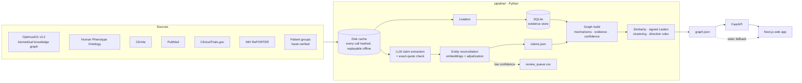

# Rare Disease Atlas

**Accurate enough for researchers. Clear enough for families.**

A knowledge graph and web app that helps a patient group facing an untreated rare disease find who shares their disease's biology, what useful work already exists, and what to do next — with every connection backed by a source, and an honest "we don't know" where the evidence runs out.

**Live demo:** https://pyridrare-disease-atlasrare-disease-atlas.replit.app

Built for Hack-Nation's 7th Global AI Hackathon, Challenge 05: *AI Atlas for the World's Rare Diseases* (OpenAI × Buffalo Initiative).

> **Research navigation, not medical advice.** The atlas contains no dosing information. Outreach drafts are drafts; nothing is ever sent.

---

## Why this matters

Rare disease knowledge is scattered across papers, databases, trial registries and patient organisations, and disease *names* hide the biology. The same gene can break in opposite directions and cause different diseases; different genes can break the same step and cause the same one. A family that knows only a gene name cannot tell which research applies to them.

We test the idea on one compact, well-understood family of diseases — the **JAK-STAT pathway** (STAT1, STAT3, JAK1, JAK2, JAK3, TYK2, IL2RG) — because it has an answer key we could write down before building ([`docs/test-cluster-desc.md`](docs/test-cluster-desc.md)).

## What the atlas shows

| Insight | What you see |
| --- | --- |
| **Names hide mechanisms** | STAT1 *gain-of-function* and STAT1 *loss-of-function* land in different clusters, although they share a gene. JAK3 and IL2RG immunodeficiencies cluster together, although their genes differ. Acquired (somatic) JAK2 blood cancers stay apart from inherited immune diseases. |
| **Disagreement is surfaced, not hidden** | The ruxolitinib → STAT1 gain-of-function edge shows **15 supporting and 4 contradicting** papers side by side, each with a verbatim quote, labelled *promising · contested · small-n*. |
| **Tempting but wrong ideas are flagged** | A drug that *dampens* the pathway, linked to a disease where the pathway is already *too weak*, is marked **inferred, unsupported — direction mismatch** (104 such edges). |
| **Honest gaps** | When nothing supports a route, the atlas says so and lists the searches it ran — e.g. 12 directory searches (NORD, Global Genes, Orphanet, EURORDIS, …) that found **no patient group dedicated to STAT1 gain-of-function**, and STAT1 N574I, which ClinVar does not hold. |

---

## Try it

Open the [live demo](https://pyridrare-disease-atlasrare-disease-atlas.replit.app) or run it locally (see [Run it](#run-it)), then follow one of these journeys.

**Maria — patient-group leader.** Her child carries a STAT1 gain-of-function variant.
1. Search **`STAT1 T419R`** (or `STAT1 R274Q`): the variant links to its mechanism, *STAT1 gain of function*, through variant-specific literature claims.
2. Open the disease (*immunodeficiency 31C*): 42 phenotypes, its cluster, and STAT3 gain-of-function as a mechanistic neighbour. STAT1 loss-of-function sits in a different cluster.
3. Search **`ruxolitinib`** and open its treatment edge: supporting and contradicting evidence side by side, small-n.
4. **Act** tab: the Immune Deficiency Foundation, USIDNET registry and Jeffrey Modell Foundation, each with a verdict (*reusable now* / *needs expert review*) and what differs; researchers drawn from the papers, with public profile links; a **Draft** proposal for shared research (never sent).
5. **Gaps** tab: the directory searches that found no dedicated STAT1 gain-of-function group, and what evidence would change the answer.

**Priya — biotech scout.** Open **Mechanism search → dampen**: diseases caused by over-active signalling, ranked by evidence level with their communities; loss-of-function diseases excluded with the reason.

**An honest gap.** Search **`ABCF2-H2BK1`**, a real gene the pipeline picked because it has no disease, drug or pathway connections: the atlas answers *no supported route*, shows the seven searches it ran, and suggests a next question.

---

## How it works



1. **Collect.** Loaders pull a focused slice of [OptimusKG](https://optimuskg.ai) (genes, diseases, phenotypes, pathways, drugs), the full HPO ontology, ClinVar variants for the seven genes, ClinicalTrials.gov studies, NIH grants, and PubMed abstracts. Every network and model call is cached on disk, so the graph rebuilds identically without the internet.
2. **Extract.** An LLM reads each abstract and returns structured claims (subject, predicate, object, study type, number of patients). A claim survives only if its quote appears **verbatim** in the abstract.
3. **Reconcile.** Each mention is matched to a graph node from a shortlist built with embeddings; the model may answer "none". Low-confidence matches go to a review queue, never into the graph.
4. **Build.** Every edge gets a confidence score with its raw inputs, an evidence class (*observed* from a database, *extracted* from a paper, *inferred* by a rule), and its supporting and contradicting citations.
5. **Analyse.** Diseases are compared by mechanism, IC-weighted phenotype overlap and conflict penalties, clustered with signed Leiden at three weightings, and checked by direction rules.
6. **Serve.** A FastAPI service and a Next.js app render search, a force-directed map, an evidence drawer, an action view and a gaps view. If the API is unavailable the app reads `graph.json` as static files.

### What's in the graph

| | |
| --- | --- |
| **Nodes** | 2,903 — 931 phenotypes, 610 variants, 335 pathways, 249 genes, 243 papers, 209 researchers, 147 diseases, 107 drugs, 54 studies, 11 mechanisms, 7 patient groups and registries |
| **Edges** | 8,536 — 7,814 observed, 51 extracted, 671 inferred |
| **Claims** | 935 quote-verified literature claims |
| **Clusters** | 117 (107 robust across all three weightings) |
| **Logged searches** | 2,539 across 947 entities, 1,661 of them with zero hits |

---

## Evidence model

Every edge in [`graph.json`](data/build/graph.json) carries the same fields, enforced by the Pydantic contract in [`pipeline/models.py`](pipeline/models.py) (JSON Schema: [`docs/graph.schema.json`](docs/graph.schema.json)):

- **sources** with dates (PMID, DOI, NCT number, database record or URL)
- **evidence class**: `observed` · `extracted` · `inferred`
- **confidence** from 0 to 1, with the raw inputs in `confidence_basis`
- **status**: `supported` · `contested` · `small_n` · `inferred_unsupported`
- **supporting** and **contradicting** claim ids

Rules the build enforces:

1. **No invented facts or hand-typed identifiers.** Seed files hold names and search terms; every id is resolved by the pipeline.
2. **Failed lookups are data.** Every search is logged in `meta.coverage`, including zero-hit ones, so gaps are visible.
3. **Exact quotes.** A claim whose quote does not match its abstract is dropped (1 of 936).
4. **Inferred edges never exceed 0.5 confidence** and are always labelled as inferred.
5. **Mechanism direction matters.** Gain-of-function, loss-of-function and dominant-negative are separate nodes; variants are never merged.
6. **Not medical advice.** Dose text, e-mail addresses and phone numbers are scrubbed from everything exported.

### Confidence

| Evidence | Score |
| --- | --- |
| Database disease–gene | From OptimusKG's evidence score, normalised; small bonus for multiple sources |
| Phenotype annotations | Published clinical study and author statement above electronic inference |
| ClinVar condition | By review status: practice guideline 1.0 → no assertion criteria 0.3 |
| Literature claims | Per claim by study type: trial 1.0 · cohort 0.8 · case series 0.6 · case report 0.4 · review 0.5 · in vitro 0.3. Edge = best claim + 0.05 per additional supporting claim, reduced when claims contradict |
| Treatment edges | Both supporting and contradicting claims → *contested*; every patient-level study under 10 patients → *small-n* |
| Registries and patient groups | 0.8 when the verified page names the disease; 0.5 or less when linked by rule (shared mechanism or umbrella disease) |
| Similarity and rules | Inferred, capped at 0.5 |

### Similarity, clustering and rules

```
score = 0.5 · mechanism    (same direction, same origin, shared pathways)
      + 0.4 · phenotypes    (information-content-weighted overlap of HPO terms)
      − 0.6 · conflict      (opposite direction on the same gene or pathway; inherited vs acquired)
```

- **Signed Leiden clustering.** Similar pairs attract; pairs whose conflict outweighs their similarity repel. Repeated at three weightings (balanced, phenotype-heavy, mechanism-heavy); a cluster is *robust* when its membership holds across all three.
- **Direction rule.** A pathway-inhibiting drug linked to a loss-of-function disease becomes an *inferred, unsupported* edge with the reason "direction mismatch". The same scan marks gain-of-function matches as hypotheses, never as leads.
- All weights and thresholds live in [`pipeline/seeds/logic.yaml`](pipeline/seeds/logic.yaml). No rule names a specific gene or disease.

---

## Results

**Ground-truth tests** — written before the graph was built ([`tests/test_ground_truth.py`](tests/test_ground_truth.py)); all seven pass.

| # | Question | Result |
| --- | --- | --- |
| 1 | Do STAT1 gain- and loss-of-function land in different clusters with different phenotypes? | ✅ |
| 2 | Do JAK3 and IL2RG immunodeficiencies cluster together? | ✅ |
| 3 | Do somatic JAK2 blood cancers stay apart from inherited immune diseases? | ✅ |
| 4 | Does the JAK inhibitor → STAT1 gain-of-function edge show both supporting and contradicting evidence? | ✅ 15 vs 4, contested, small-n |
| 5 | Is a JAK inhibitor → loss-of-function disease edge flagged as unsupported? | ✅ 104 direction-mismatch edges |
| 6 | Does a gene with no connections return "no supported route", with the searches and a next question? | ✅ via the live API |
| 7 | Are STAT1 variants kept distinct, with variant-specific mechanism evidence? | ✅ 6 variants |

**Ablation.** With the conflict penalties switched off, tests 1–3 still pass, but 13 directly conflicting pairs (e.g. STAT1 gain- vs loss-of-function) become similarity edges, and cluster membership shifts (the largest cluster splits from 13 to 9 members). The penalties keep conflicting diseases from being drawn as neighbours even where clustering alone separates them.

**Extraction.** 265 papers retrieved (all seven key papers from the cluster brief included), 936 claims extracted, **935 kept** after the exact-quote check. 147 claims attach to graph edges; the rest name entities outside the slice and are logged as unresolved mentions. Precision on a 40-claim human-labelled sample: *not yet measured* ([`eval/`](eval/)).

**Reproducibility.** `ATLAS_OFFLINE=1 make data` rebuilds `graph.json` in about 48 seconds; repeated rebuilds are byte-identical apart from the build timestamp. `make test` runs 812 Python tests (pipeline, contract, ground truth and API).

---

## AI models

| Use | Where | Model |
| --- | --- | --- |
| Claim extraction (structured outputs) | [`pipeline/extract/claims.py`](pipeline/extract/claims.py) | Set by `OPENAI_MODEL`, or another provider via `ATLAS_LLM_PROVIDER`. The checked-in `claims.json` records the model that produced it: `claude-sonnet-5-5`. |
| Entity reconciliation | [`pipeline/extract/reconcile.py`](pipeline/extract/reconcile.py) | OpenAI embeddings (`OPENAI_EMBED_MODEL`) for the shortlist; the same chat model adjudicates |
| Plain-language explanations and drafts | [`pipeline/llm/`](pipeline/llm/) | Same chat model. A validator rejects any sentence without a citation or with an id that is not in the graph, retries once, then falls back to a template built only from graph fields. |

Every model call is cached on disk, so the demo never depends on a live model. Details: [`docs/evidence-pipeline.md`](docs/evidence-pipeline.md).

---

## Run it

Requirements: Python 3.12 with [uv](https://docs.astral.sh/uv/), Node.js for the web app.

```bash
uv sync
(cd web && npm ci)
make test        # pipeline, contract, ground-truth and API tests
make dev         # API on :8000 and the web app on :3000
```

The built graph is checked in, so `make test` and `make dev` work on a fresh clone.

**Rebuilding the graph.**

```bash
cp .env.example .env    # optional NCBI_API_KEY; model keys only to re-run extraction
make data               # first run is online: ~208 MB of downloads into data/raw
ATLAS_OFFLINE=1 make data   # later runs replay the cache and fail fast on a miss
```

`make data` reuses the checked-in `claims.json`; re-running the literature pipeline needs a model key (see [`docs/evidence-pipeline.md`](docs/evidence-pipeline.md)).

**Deploying.** [`render.yaml`](render.yaml) + [`api/Dockerfile`](api/Dockerfile) for the API; the web app deploys to any Next.js host with `NEXT_PUBLIC_API_URL` pointing at the API. `.replit` and `scripts/replit-*.sh` run both on one origin.

---

## Repository layout

```
pipeline/
  sources/      optimuskg, hpo, clinvar, ctgov, reporter, pubmed loaders
  extract/      LLM claim extraction, reconciliation, investigators
  llm/          model client, explain, draft, citation validator
  graph/        build, mechanisms, evidence, confidence, similarity, cluster, rules, logic
  seeds/        names and search terms only (genes, diseases, patient groups, thresholds)
  models.py     the graph.json contract
  export.py     make data entry point
api/            FastAPI service
web/            Next.js app
tests/          pipeline, contract and ground-truth tests
eval/           extraction precision sample
data/build/     graph.json, build_report.json, claims.json, papers.json
docs/           cluster brief, backbone evaluation, source API notes, evidence pipeline, graph schema
```

---

## Data sources and licences

| Source | Version | Licence |
| --- | --- | --- |
| [OptimusKG](https://doi.org/10.7910/DVN/IYNGEV) | 3.2 (2026-09-09) | **CC BY-NC-SA 4.0** — the derived `graph.json` inherits non-commercial, share-alike and attribution terms. Upstream sources include DisGeNET (CC BY-NC-SA 4.0) and DrugBank (commercial use restricted). |
| [Human Phenotype Ontology](https://hpo.jax.org) | 2026-09-02 | HPO licence: cite the consortium, show the version, do not alter |
| [ClinVar](https://www.ncbi.nlm.nih.gov/clinvar/) | Build 2026-09-29 | Public domain (NCBI) |
| [ClinicalTrials.gov](https://clinicaltrials.gov) API v2 | data 2026-10-02 | ClinicalTrials.gov terms (attribution, show the processed date) |
| [NIH RePORTER](https://reporter.nih.gov) API v2 | fiscal years 2022–2027 | U.S. Government work |
| PubMed abstracts | retrieved 2026-10-03 | NLM terms |
| Patient groups | 7 organisations, each URL verified 2026-10-03 | Team-curated |

*This service uses the Human Phenotype Ontology (version 2026-09-02). Find out more at http://www.human-phenotype-ontology.org.*

Full per-source detail, including the upstream sources whose terms were not individually verified: [`docs/source-apis.md`](docs/source-apis.md) and [`docs/optimuskg-spike.md`](docs/optimuskg-spike.md).

---

## Known limitations

- **Free-text symptom search.** Searching symptoms in everyday language ("recurring candida infections and thyroid problems") matches words, not HPO concepts, so the right disease does not yet rank first.
- **Explanations are templated.** No model-written explanations are precomputed for the demo, so the explain and draft features use the citation-checked template.
- **Literature coverage.** 788 of 935 claims name genes, diseases or variants outside the seven-gene slice and stay unattached; 1,090 reconciliation candidates wait in the review queue.
- **STAT1 R274W** has no variant-specific mechanism claim in the retrieved papers (its only claim describes a binding effect), so the demo uses T419R or R274Q.
- **STAT1 gain-of-function → mechanism** is marked *contested* because two pharmacodynamics claims were extracted as contradicting it.
- **STAT3 gain-of-function** has no phenotype annotations in the backbone; it clusters on mechanism and pathway alone.
- **Researchers** without an ORCID are matched by name and flagged low-confidence; NIH RePORTER exposes no ORCID.
- **Licences** of 24 upstream sources inside OptimusKG were not individually verified.

---

## Toward 10×

**Milestone.** Decide whether a JAK inhibitor is a credible candidate for a specific STAT1 gain-of-function variant, or design a shared natural-history and treatment-response study across variants.

**Today.** Single-patient and small-series reports, published separately, some contradicting each other.

**With the atlas.** One view that aligns each reported treatment response to the patient's variant and mechanism, grades the evidence, flags contradictions, and links the registry and the researchers who could pool data.

**Assumptions to validate.** Treatment response depends on variant mechanism; enough treated patients are reported with variant detail; registries and researchers would share data; the time saved is in assembling evidence and finding partners. We state no 10× figure until the current timeline is measured.
