# Rare Disease Atlas: JAK-STAT MVP

Hack-Nation 7th Global AI Hackathon, Challenge 05: *AI Atlas for the World's Rare Diseases* (OpenAI x Buffalo Initiative).

> **Research navigation, not medical advice.** No dosing information appears anywhere in this project. Outreach drafts are drafts; nothing is ever sent.

**Deadline:** 9:00 AM ET, Sun Oct 4 2026. **Internal submit target:** 8:30 AM ET.
**Deliverables (per the brief):**
- **Working prototype**, deployed (or easy to run locally) so judges can search and explore it live. We deploy it and check it works while logged out.
- **Source code repository** with a README covering the architecture and how to reproduce the dataset (this file).
- **A team video and a 1-minute walkthrough.** The walkthrough follows a family or patient group through the graph to either a justified collaboration and next step, or an honest gap with a plan to investigate it. Our walkthrough is Maria's journey (Section 11). The team records both.

**Brief:** *Challenge 05: AI Atlas for the World's Rare Diseases* (Hack-Nation × OpenAI × Buffalo Initiative). Section 15 maps each brief requirement to where this plan covers it.

> **Status: planning.** This README is the build plan. Sections marked _(to fill)_ are written as the pipeline produces real results. Nothing in this file is presented as sourced until the pipeline retrieves it.

---

## 1. What the MVP proves

One complete journey: **disease → supported connection → existing asset → collaborator → concrete next step**, or an **honest gap** where no supported route exists. Every edge is explained and cited.

In the JAK-STAT test cluster ([`docs/test-cluster-desc.md`](docs/test-cluster-desc.md), the source of truth), that means three demonstrations:

| Claim | How the atlas shows it |
| --- | --- |
| **Names hide mechanisms** | STAT1 GoF and STAT1 LoF land in different clusters; JAK3 SCID and IL2RG SCID cluster together; somatic JAK2 myeloproliferative disease does not cluster with germline immunodeficiencies |
| **Contradictory evidence is surfaced** | Ruxolitinib → STAT1 GoF shows supporting and contradicting papers side by side, labeled small-n |
| **Unsupported links are flagged** | A JAK inhibitor linked to a LoF disease is marked `inferred_unsupported` ("direction mismatch") |

The brief's bar ("What good looks like"): Maria types her disease into one search box and follows it to a disrupted pathway, another gene, a related disease and the patient group working on it, with every edge explained and sourced. She finds an existing registry and study design, and sees what is reusable, what differs between the diseases, and which biological or eligibility questions need expert review. She leaves with a sourced proposal for shared research, or with a clear account of what is unknown and a next question to test. The aim is an action a patient-group leader can take **this week**.

| Judging criterion (brief wording) | What judges look for | Where we deliver it |
| --- | --- | --- |
| Graph quality | Node/edge design, defensible clustering, useful paths, counterexamples, treatment of uncertainty | Sections 4, 6, 8 (STAT1 GoF/LoF, somatic JAK2 counterexamples) |
| Evidence integrity | Sourced, cross-checked claims that separate data from hypotheses and clinical proof | Hard rules, evidence classes, quote check, evidence drawer |
| Patient progress | Isolated diagnosis → justified collaboration, reusable asset, next milestone | Maria's journey, Act tab, Draft |
| 10× impact | Milestone, existing timeline vs our route, assumptions | 10× card (Section 10), Section 16 |
| Ambition and product craft | Intuitive experience for collaboration at a scale no single community reaches | Frontend (Section 10) |

Track prizes require visible use of OpenAI models (Section 7).

---

## 2. Hard rules (apply to every PR)

1. **No invented facts.** No fabricated identifiers, PMIDs, URLs, people, counts or quotes.
2. **No hand-typed IDs.** The pipeline resolves every ID. Seeds contain names and search terms, not IDs.
3. **Failed lookups are data.** A failed or empty lookup is written to `meta.coverage` as a gap.
4. **Required edge fields:** sources, date, relation, evidence class (`observed | extracted | inferred`), confidence 0–1 with basis, supporting citations, contradicting citations.
5. **Quote matching.** Every extracted claim carries a quote that string-matches its source abstract after whitespace normalization. Non-matching claims are dropped (and counted).
6. **Caching.** Every network and LLM call is cached on disk under `data/cache/`, keyed by a hash of the request. The demo never depends on live calls.
7. **Not medical advice.** No dosing. Footer: "Research navigation, not medical advice." Drafts are never sent.
8. **Secrets** live in `.env` (`OPENAI_API_KEY`, optional `NCBI_API_KEY`). `.env.example` is committed.
9. **Model names** come from `OPENAI_MODEL` and `OPENAI_EMBED_MODEL`; check OpenAI's current docs for model names and the structured-outputs API before coding against them.
10. **[Background] facts** from the cluster doc guide what to look up. They never appear in the graph, UI, README or video as sourced until retrieved.

---

## 3. Architecture

```mermaid
flowchart LR
  subgraph Sources
    OKG[OptimusKG Parquet<br/>stratified slices]
    CV[ClinVar<br/>E-utilities]
    PM[PubMed<br/>E-utilities]
    CT[ClinicalTrials.gov v2]
    RP[NIH RePORTER v2]
    PG[patient_groups.yaml<br/>hand-curated, URL-verified]
  end

  Cache[(data/cache/<br/>hash-keyed HTTP + LLM)]
  Sources --> Cache

  subgraph Pipeline [pipeline/ — Python, uv, Polars]
    Load[sources/*.py] --> DB[(SQLite evidence store)]
    DB --> Extract[extract/claims.py<br/>OpenAI structured outputs<br/>+ quote check]
    Extract --> Reconcile[extract/reconcile.py<br/>embeddings top-5 + model adjudication]
    Reconcile --> DB
    Reconcile -.low confidence.-> RQ[data/review_queue.csv]
    DB --> Build[graph/build.py]
    Build --> Conf[graph/confidence.py]
    Conf --> Sim[graph/similarity.py]
    Sim --> Clu[graph/cluster.py<br/>Leiden x3 weightings]
    Clu --> Rules[graph/rules.py]
    Rules --> Export[export.py]
  end

  Cache --> Load
  Export --> GJ[data/build/graph.json<br/>+ JSON Schema]
  Export --> Pre[precomputed explanations<br/>for demo journeys]

  GJ --> API[FastAPI api/<br/>Render or Fly]
  Pre --> API
  API -->|/explain /draft live, cached| OAI[OpenAI]
  API --> Web[Next.js + Cytoscape.js<br/>Vercel]
  GJ -.fallback: static files.-> Web
```



**Fallback mode.** If the API deploy is blocked, the web app reads `graph.json` and the precomputed explanations as static files. Live LLM features (`/explain`, `/draft` on arbitrary input) degrade to "cached only" instead of erroring.

### Stack

| Layer | Choice |
| --- | --- |
| Language / tooling | Python 3.11+, `uv` |
| Tabular data | Polars |
| Evidence store | SQLite |
| Graph / clustering | NetworkX, `igraph` + `leidenalg` |
| Tests | `pytest` |
| API | FastAPI |
| Frontend | Next.js (TypeScript), Cytoscape.js |
| Deploy | Vercel (web); Render or Fly (API) |

### Repo layout

```
pipeline/
  sources/      optimuskg.py, clinvar.py, pubmed.py, ctgov.py, reporter.py
  seeds/        patient_groups.yaml          (hand-curated, every row verified)
  extract/      claims.py, reconcile.py
  graph/        build.py, confidence.py, similarity.py, cluster.py, rules.py
  cache.py      hash-keyed disk cache for HTTP + LLM calls
  export.py     writes data/build/graph.json
  models.py     Pydantic models = the graph.json contract
api/            FastAPI app
web/            Next.js app
tests/          test_ground_truth.py, test_contract.py
eval/           claims_review.csv + precision.py
data/           raw/ and cache/ (gitignored), build/, review_queue.csv
docs/           test-cluster-desc.md, challenge-brief.pdf, optimuskg-spike.md, graph.schema.json
Makefile        make data | make test | make dev
```

> M0 housekeeping: `test-cluster-desc.md` currently sits at the repo root; move it to `docs/`.

---

## 4. The `graph.json` contract (frozen at end of M0)

Defined as Pydantic models in `pipeline/models.py`; JSON Schema generated to `docs/graph.schema.json`; a mock `graph.json` validating against it unblocks the frontend immediately. **Changing the contract after M0 requires team sign-off.**

```json
{
  "meta": {
    "built_at": "ISO timestamp",
    "sources": [{"name": "", "version": "", "retrieved_at": "", "license": ""}],
    "coverage": {"<entity id>": {"searched": [{"source": "", "query": "", "date": "", "hits": 0}]}}
  },
  "nodes": [
    {"id": "<resolved CURIE or internal id>", "type": "Gene", "label": "", "synonyms": [], "props": {}}
  ],
  "edges": [
    {
      "id": "e_000001",
      "source": "", "target": "", "relation": "",
      "evidence_class": "observed | extracted | inferred",
      "confidence": 0.0,
      "confidence_basis": {"raw values used": "..."},
      "status": "supported | contested | small_n | inferred_unsupported",
      "sources": [{"kind": "pmid | db | url | nct", "id": "", "date": ""}],
      "supporting": ["claim ids"],
      "contradicting": ["claim ids"],
      "attributes": {"origin": "germline | somatic"}
    }
  ],
  "claims": [
    {
      "id": "c_000001", "pmid": "", "quote": "", "polarity": "supports | contradicts",
      "subject": "", "predicate": "", "object": "", "variant": "",
      "study_type": "trial | cohort | case_series | case_report | in_vitro | review",
      "n_patients": null
    }
  ],
  "clusters": [{"id": "", "members": [], "robust": true, "why": {}}]
}
```

**Node types:** Gene, Variant, Mechanism, Disease, Phenotype, Pathway, Drug, Claim (→ Paper), Paper, Investigator, PatientGroup, Registry, Study.

**Mechanism nodes:** `mech:<GENE>:<DIRECTION>[:somatic]`, DIRECTION ∈ {`GoF`, `LoF`, `DN`}. Variant-specific sub-routes (e.g. a variant with distinct nuclear-accumulation behaviour) are claims on the variant → mechanism edge. **Variants are never collapsed into one node** (ground-truth test 7).

**Germline vs somatic:** `attributes.origin` on disease–gene and disease–mechanism edges.

**Contract decisions to settle in M0** (open questions, not yet decided):
- Add `doi` to `sources[].kind` for preprints (bioRxiv NK-cell study), plus a `preprint` flag.
- Asset comparison fields, so the Act tab can show what differs and what needs expert review: e.g. `attributes.verdict`, `attributes.differs: [...]`, `attributes.needs_review: ["biological" | "eligibility"]` on asset→disease edges.
- Investigator `props.contact`: only a public source URL, never a guessed address.
- `status` is a single enum, but treatment edges need a combined label ("promising, contested, small-n"). Proposal: keep `status` as the dominant value and add `attributes.labels: [...]` for the full set — decide before freeze.
- Where cluster-level information lives for mechanism-level disease entities vs. raw disease nodes.
- Similarity edges: `relation: "similar_to"`, `evidence_class: "inferred"`, score breakdown in `confidence_basis`.

---

## 5. Data sources

| Layer | Source | Scope / notes |
| --- | --- | --- |
| **Backbone** | OptimusKG (arXiv 2604.27269; Harvard Dataverse doi:10.7910/DVN/IYNGEV; PyPI `optimuskg`; docs optimuskg.ai/docs) | Stratified Parquet only. Nodes: gene, disease, phenotype, pathway, drug. Edges: disease–gene, disease–phenotype, phenotype–phenotype, pathway–gene, GO process–gene, drug–gene, drug–disease. **Never load the full graph** (~21.8M edges). Read the client docs; don't guess the API. |
| Backbone fallback | HPO `phenotype.hpoa` + `hp.json`, MONDO, HGNC, Reactome, GO annotations | Only if the OptimusKG spike fails its exit criteria |
| OMIM (brief: biology engine) | OMIM API | Optional. Needs a registered API key and has restrictive terms, so **ask before using it**. Without it, OMIM cross-references come only via MONDO / ClinVar. |
| Variants | ClinVar via NCBI E-utilities | All cluster genes. Must include the STAT1 variants named in the cluster doc (R274W, T419R, N574I, R321 position). IDs and HGVS resolved, not typed. |
| Papers / claims | PubMed E-utilities (PubTator3 optional) | Every Section 11 paper, resolved to PMID. Two digest-only papers (STAT1 systematic review; transcriptional profiling) searched by title. Cap ~300 abstracts total; cap JAK2 MPN literature at ~30. A paper that does not resolve is logged as a coverage gap. |
| Studies | ClinicalTrials.gov API v2 | JAK inhibitors × STAT1 GoF / CMC / related. Log exact query + date even on zero hits. Per the brief, record eligibility criteria and mechanism for each study, so the Act tab can flag eligibility or mechanism questions before suggesting a shared trial. |
| Preprints | bioRxiv / medRxiv API | The Section 11 NK-cell study is a bioRxiv preprint (doi 10.1101/157271). Resolve its DOI and abstract through the bioRxiv API and use `sources.kind: "doi"`. Label it **preprint** in the UI. |
| Grants / investigators | NIH RePORTER v2; PubMed author lists | ORCID when present; else name + affiliation, flagged `low`. Label as "author of N papers on X", never "field leader". Contact routes come only from public sources (institutional page, corresponding-author address on the paper); never guess emails. |
| Patient groups / registries | `pipeline/seeds/patient_groups.yaml` | Start: IDF, USIDNET, Jeffrey Modell Foundation. Fetch each URL, record `retrieved_at`. Search the brief's directories (NORD, Global Genes, Orphanet, EURORDIS, Rare Disease UK, Genetic Alliance, plus RareConnect as a stretch) for a dedicated STAT1 GoF group; log every search. No group found → honest-gap output. |

**Phenotype information content** is computed across **all** HPO-annotated diseases, not just our slice.

**Rate limits:** NCBI ≤3 req/s without a key, ≤10 with `NCBI_API_KEY`. Enforced in `pipeline/cache.py`'s HTTP client.

### OptimusKG spike (time box: 45 min)

Exit criteria, both required:
1. STAT1, STAT3, JAK1, JAK2, JAK3, TYK2, IL2RG each resolve to a single gene node.
2. Cluster diseases have disease–phenotype edges.

Findings and the go / fallback decision go in `docs/optimuskg-spike.md`. Also record the observed range of `evidence_score` (needed for the confidence rubric).

### Licenses _(to fill with versions + retrieval dates)_

| Source | Version | Retrieved | License |
| --- | --- | --- | --- |
| OptimusKG data | | | CC BY-NC-SA 4.0 (code MIT) |
| Upstream via OptimusKG (e.g. DisGeNET, DrugBank) | | | Restrict commercial use — verify each |
| ClinVar, PubMed, ClinicalTrials.gov, RePORTER | | | Public (NCBI / NLM / NIH terms) |
| HPO, MONDO, Reactome, GO | | | Per project license — verify |
| bioRxiv / medRxiv preprints | | | Per-article license (often CC BY / CC BY-NC-ND) — verify |
| OMIM (if used) | | | Restricted; API key + terms of use |

---

## 6. Graph logic

### Confidence rubric (`pipeline/graph/confidence.py`)

Raw inputs are always kept in `confidence_basis`.

| Evidence | Scoring |
| --- | --- |
| OptimusKG disease–gene | From `evidence_score` (normalized after checking its range); small bonus for multiple sources or high `number_of_pmids` |
| GO edges | Experimental evidence codes high; IEA low |
| HPO edges | PCS / TAS above IEA |
| `relation_conflict` set | Downgrade; surface conflicting assertions in the evidence drawer |
| Extracted claims | trial > cohort > case series > case report > in vitro; verified quote required |
| Treatment edges | Aggregate claims. Supporting + contradicting both present → `contested`. Every study < 10 patients → `small_n`. Combined display label, e.g. "promising, contested, small-n" |
| Inferred edges (rules / similarity) | Capped at 0.5; always labeled inferred |

### Similarity (`pipeline/graph/similarity.py`)

Between mechanism-level disease entities:

```
sim = w_m · mechanism_score          # same pathway step, same direction, same origin
    + w_p · ic_weighted_phenotype_overlap
    − w_c · conflict_penalty         # opposite direction on same gene/pathway; germline vs somatic
```

Full score breakdown stored on every similarity edge so the UI can say *why* two diseases are neighbours. Penalties are **general rules** documented here — never special-cased for specific genes.

### Clustering (`pipeline/graph/cluster.py`)

- Leiden on the similarity graph.
- Re-run at three weightings of (w_m, w_p, w_c); a cluster whose membership holds across all three is `robust`, otherwise `sensitive`.
- **Ablation:** re-run with penalties off (phenotype + pathway only) and report whether tests 1–3 still pass. _(results to fill)_

### Rules (`pipeline/graph/rules.py`)

- Pathway-inhibiting drug → LoF mechanism ⇒ edge with `status: inferred_unsupported`, reason "direction mismatch".

---

## 7. How OpenAI models are used

All three uses are visible in the UI and the video. Every LLM call is cached under `data/cache/`.

1. **Extract** (`pipeline/extract/claims.py`). Structured outputs over PubMed abstracts → claim objects matching the contract, including `study_type` and `n_patients`. Claims whose quote fails the string-match check are dropped and counted.
2. **Reconcile** (`pipeline/extract/reconcile.py`). Embeddings index over node labels + synonyms; top-5 shortlist per mention; the model picks one or "none". Low-confidence matches go to `data/review_queue.csv`, never the graph. Same mechanism maps free-text symptoms → HPO terms (Devon's journey).
3. **Explain and draft** (`api/`). Given a path or subgraph, produce plain-language text where **every sentence cites ≥1 edge or claim ID**. A validator rejects uncited sentences or IDs not in the input → one retry → templated fallback. All demo-journey explanations are precomputed at build time.

---

## 8. Ground-truth tests (`tests/test_ground_truth.py`)

Written first (M0), all `xfail`; markers removed as each passes. Run against the built graph and the API.

| # | Test | Pass condition | Target milestone |
| --- | --- | --- | --- |
| 1 | STAT1 GoF vs LoF | Different clusters, different phenotype profiles | M3 |
| 2 | JAK3 SCID and IL2RG SCID | Same cluster | M3 |
| 3 | Somatic JAK2 MPN | Not clustered with germline immunodeficiencies | M3 |
| 4 | JAK inhibitor → STAT1 GoF | Both supporting and contradicting citations | M3 |
| 5 | JAK inhibitor → LoF disease (e.g. JAK3 SCID) | `inferred_unsupported` | M3 |
| 6 | Obscure gene, no connections | API returns `no_supported_route` + search coverage + a next question | M4 |
| 7 | STAT1 GoF variants | Distinct variant nodes with variant-specific mechanism claims | M3 |

Test 6 gene: _(to choose from the built graph and document here)_.

`tests/test_contract.py` validates `graph.json` (mock and real) against the JSON Schema and checks every edge's required fields, every claim ID referenced by an edge exists, and every claim's quote matches its cached abstract.

---

## 9. API (FastAPI)

| Endpoint | Purpose |
| --- | --- |
| `GET /search?q=` | One global search: disease, gene, variant, symptom (free text), patient group or mechanism → resolved entity, the synonym it matched on, and how it was resolved |
| `GET /entity/{id}` | Summary-card data and neighbours |
| `GET /cluster/{id}` | Members and why they belong together |
| `GET /edge/{id}` | Full evidence: claims, quotes, sources, confidence basis, contradictions |
| `POST /explain` | Node/path IDs → cited plain-language explanation |
| `POST /draft` | Sourced outreach / proposal draft. Never sent. |
| `GET /gaps/{id}` | Coverage, missing evidence, what would change the answer |
| `GET /mechanism-search?direction=dampen` | GoF diseases ranked; LoF excluded with reason (Priya) |

---

## 10. Frontend

One global search box (disease, gene, symptom, patient group or mechanism, with the synonym match shown, e.g. "matched *CMC* → …") → entity page. **Progressive reveal:** summary first, depth on click. Tabs:

- **Summary** — three plain-language lines (what is broken, who shares it, what already exists), each linked to its edge.
- **Map** — Cytoscape. Colour = cluster only. Size = centrality. Dashed = inter-cluster bridge. Opens at cluster level, ≤ ~40 nodes visible.
- **Evidence drawer** — opens from any edge: relation, evidence-class badge, confidence + basis, quote + link, supporting vs contradicting side by side.
- **Act** (the brief's "patient action view") — separates viable leads from unsupported links.
  - Assets (registries, natural-history studies, models, biomarkers, clinical studies), each with a verdict (reusable now / adaptable, needs expert review / not transferable), **what differs** between the diseases, and which **biological or eligibility questions** need expert review.
  - Investigators, each with a public contact route when one exists.
  - Next step, with a **Draft** button: a sourced proposal for shared research, framed as something to do this week.
  - 10× card: the milestone, the existing timeline vs our route, and its assumptions. No 10× number unless it is sourced.
- **Gaps** — coverage, missing evidence, what would change the answer.

Low-ink, whitespace, phone-usable. Footer: "Research navigation, not medical advice."

---

## 11. Demo journeys (must work on the deployed site, fully cached)

**1. Maria — hero journey (never cut)**
1. Search "STAT1 R274W".
2. Variant → mechanism (GoF) with the variant-specific route claim.
3. STAT1 GoF disease + phenotypes; STAT1 LoF shown as a separate cluster.
4. STAT3 GoF as a neighbour.
5. Ruxolitinib edge: mixed evidence side by side, small-n. The GoF/LoF evidence-imbalance figure appears **only if** the systematic review was actually retrieved.
6. USIDNET registry and IDF materials as assets.
7. Investigators drawn from the papers.
8. Next step: draft proposal to pool variant-level treatment responses via the registry. If verified, the "no dedicated STAT1 GoF group" gap.

**2. Devon** — "recurring candida infections and thyroid problems" → HPO terms → STAT1 GoF ranks high, plain-language explanation, closest community.

**3. Priya** — mechanism search "dampen JAK-STAT signaling" → GoF diseases ranked by evidence level with communities; LoF diseases excluded with the reason shown.

**4. Dr. Osei (stretch)** — "who else works on my mechanism, across every gene name it hides under": investigators who bridge subclusters, each with a public contact route.

**Brief stretch goals (only if time allows after M5; never at the hero journey's expense)**
- Propose an experiment that tests a shared mechanism (e.g. variant-level pooling of treatment responses) as a `/draft` template.
- A "contribute missing evidence" form on the Gaps tab that writes to a review queue and never straight into the graph.
- Optional per the brief: funders and investors (RePORTER funding ICs, RFA signals) on Maria's Act tab. Sourced only.

---

## 12. Build plan

Times are ET on Sat Oct 3 → Sun Oct 4. If we start late, shift proportionally. Commit at the end of each milestone and tick it here.

### Milestones

- [ ] **M0 — Scaffold and contracts** (first hour) · *done when: contract frozen*
  - [ ] `uv` project, `pyproject.toml`, `.gitignore` (`data/raw`, `data/cache`, `.env`), `.env.example`
  - [ ] `Makefile` with `data`, `test`, `dev` targets (stubs OK)
  - [ ] Move `test-cluster-desc.md` → `docs/`
  - [ ] `pipeline/cache.py`: hash-keyed disk cache + rate-limited HTTP client
  - [ ] `pipeline/models.py` Pydantic contract → `docs/graph.schema.json`
  - [ ] Hand-written mock `data/build/graph.mock.json` (clearly placeholder labels, no fake IDs/PMIDs) that validates
  - [ ] `tests/test_contract.py` passing on the mock
  - [ ] `tests/test_ground_truth.py` tests 1–7 as `xfail`
  - [ ] `web/` Next.js shell rendering the mock in Cytoscape
- [ ] **M1 — Backbone** (~5 PM) · *done when: frontend renders real data*
  - [ ] OptimusKG spike (45 min) → `docs/optimuskg-spike.md` → go / fallback decision
  - [ ] Cluster genes, diseases, phenotypes, pathways, drugs loaded into SQLite
  - [ ] HPO information content over all annotated diseases
  - [ ] `export.py` writes graph v0; frontend switched from mock to real
- [ ] **M2 — New layers** (~9 PM) · *done when: all layers in the graph*
  - [ ] ClinVar variants (incl. required STAT1 variants) + mechanism nodes
  - [ ] PubMed: Section 11 papers resolved; abstracts fetched (caps enforced)
  - [ ] Claim extraction with quote check; reconcile with review queue
  - [ ] ClinicalTrials.gov studies (queries logged, incl. zero hits)
  - [ ] Investigators from author lists; RePORTER grants
  - [ ] `patient_groups.yaml` verified; directory searches logged
- [ ] **M3 — Graph logic** (~10 PM) · *done when: tests 1–5 and 7 pass*
  - [ ] `confidence.py`, `similarity.py`, `cluster.py` (×3 weightings), `rules.py`
  - [ ] Ablation run recorded
- [ ] **GATE** (10 PM) · *Maria's journey works end to end on the deployed site, with cached explanations*
- [ ] **M4 — Remaining features** (~1 AM) · *done when: test 6 passes*
  - [ ] `/explain` + validator, `/draft`, `/gaps`, `/mechanism-search`
  - [ ] Devon and Priya journeys; all journeys precomputed
- [ ] **M5 — Polish** (3 AM) · *feature freeze*
  - [ ] UI polish, mobile pass, deploy, README sections marked _(to fill)_
- [ ] **After freeze** — bug fixes only
  - [ ] Fresh-clone `make data` reproduces `graph.json` from caches
  - [ ] `eval/claims_review.csv`: 40 random extracted claims for human labelling; `eval/precision.py`
  - [ ] Deployed URL checked logged-out on desktop + phone
  - [ ] Submit by 8:30 AM

### Ownership (parallel workstreams)

The contract is the seam: after M0, each stream works against `graph.json` / the schema and does not need the others to be done.

| Stream | Owns | Depends on | First deliverable |
| --- | --- | --- | --- |
| **Data** | `pipeline/sources/`, `pipeline/seeds/`, `pipeline/cache.py`, `pipeline/graph/`, `pipeline/export.py`, `docs/optimuskg-spike.md`, `Makefile` | contract | OptimusKG spike decision; graph v0 |
| **AI** | `pipeline/extract/`, `api/` explain / draft / search / validator, `eval/` | contract, PubMed abstracts from Data | quote-verified claims for the Section 11 papers |
| **Frontend** | `web/`, deploy (Vercel + API host) | mock `graph.json` | Cytoscape map + evidence drawer on mock data |
| **Story** | README, team video + 1-minute walkthrough, `patient_groups.yaml` verification, demo script, 10x card wording, license table | everything (reads only) | verified patient-group seeds + directory-search log |

Shared: `pipeline/models.py` (contract — change only with sign-off), `tests/`.

### Critical path

```
contract (M0) ─┬─> OptimusKG spike ─> graph v0 ─> similarity/cluster ─> tests 1–3
               ├─> PubMed resolve ─> extract + quote check ─> treatment edges ─> tests 4,5
               └─> web on mock ─────────────────────────────────────────────┐
                                                                            v
                                           GATE: Maria end-to-end on deployed site
```

The **hero journey, evidence drawer and Gaps tab are never cut.**

### Cut order if behind

1. Dr. Osei view
2. Clustering robustness re-runs
3. RePORTER grants
4. Network-overlap layer (brief Module 3.3: shared key opinion leaders across communities, i.e. researchers, clinicians, biotech reps, investors or funders. We cover researchers only.)

Any task running > 2× its time box: stop, flag it, propose a cut.

### Risks

| Risk | Mitigation |
| --- | --- |
| OptimusKG client/API differs from expectations, or genes don't resolve cleanly | Hard 45-min box; raw HPO/MONDO/HGNC/Reactome/GO fallback |
| A Section 11 paper doesn't resolve to a PMID (e.g. bioRxiv-only, digest-only) | Search by title; if unresolved, log as coverage gap and omit from claims |
| Extracted quotes fail string match | Prompt for verbatim spans; report drop rate; never relax the check |
| API deploy blocked | Static `graph.json` + precomputed explanations served from Vercel |
| Clustering only passes tests via gene-specific hacks | Forbidden; penalties are general rules, ablation reported honestly |
| NCBI rate limits / outages mid-demo | Everything cached; demo reads only from build output |

---

## 13. Reproduce the build

```bash
cp .env.example .env        # add OPENAI_API_KEY (and optionally NCBI_API_KEY)
uv sync
make data                   # rebuilds data/build/graph.json, using data/cache/ when present
make test                   # contract + ground-truth tests
make dev                    # API + web locally
```

_(Exact commands, expected runtimes and cache-archive instructions to fill once M1 lands.)_

---

## 14. Results _(to fill)_

- **Ground-truth tests:** pass/fail per test, with reasons for any failure.
- **Ablation (penalties off):** tests 1–3 pass/fail.
- **Extraction precision:** from `eval/claims_review.csv` (n = 40).
- **Quote-check drop rate:** extracted vs kept claims.
- **Known gaps:** unresolved papers, empty searches, unverified [Background] rows, honest-gap outputs.

---

## 15. Brief traceability

| Brief requirement | Where in this plan |
| --- | --- |
| Nodes: diseases, genes, variants, mechanisms, symptoms, patient groups, papers, studies, research assets | Section 4 node types |
| Edges explain the relation and cite evidence; source, date, confidence on each | Hard rule 4, contract |
| Module 1 edges: gene–variant–mechanism (OMIM, ClinVar) · disease–phenotype (HPO) · publication–claim–investigator (PubMed/PMC) · study–condition–intervention (ClinicalTrials.gov) · funding–researcher–asset (RePORTER) · patient org–disease–registry (NORD, Global Genes, Orphanet, group sites) | Section 5 |
| Module 2: show the source, observed vs inferred, contradictions; no supported route → say so, with coverage and missing evidence | Evidence drawer, `status`, Gaps tab, test 6 |
| Module 3.1: cluster by variant effect, pathway and phenotype, not by name | Section 6, tests 1–3 |
| Module 3.2: map registries, natural-history studies, models, biomarkers and studies; test adaptability | Act tab asset verdicts |
| Module 3.3: shared key opinion leaders across communities | Cut item 4 (researchers only); Dr. Osei view |
| UX: low ink, one global search with synonym resolution, progressive reveal, explain every edge, patient action view | Section 10 |
| OpenAI: Extract, Reconcile, Explain | Section 7 |
| 10×: milestone, existing timeline vs our route, assumptions | Section 16 |
| Show how the graph grows as new evidence and communities contribute | Pipeline is source-driven and cached; adding a cluster means seeds + `make data`. "Contribute missing evidence" is a stretch goal. |
| Submission: prototype, repo + README (architecture, dataset reproduction), team video + 1-min walkthrough | Header, Sections 3 and 13 |

---

## 16. 10× moonshot (hypothesis, not a result)

- **Milestone:** a decision on whether a JAK inhibitor is a credible candidate for a specific STAT1 GoF variant, or the design of a shared natural-history and treatment-response study across variants.
- **Existing route:** separate single-patient and small-series reports. Dates and timelines are filled in only from retrieved sources.
- **Our route:** one view that aligns each reported treatment response to the patient's variant and mechanism class, grades the evidence, flags contradictions, and links to the registry and the investigators who could pool data.
- **Assumptions to validate:**
  1. Treatment response depends on variant mechanism. This is the hypothesis; nothing retrieved shows it yet.
  2. Enough treated patients are reported with enough variant detail to compare them.
  3. Registry owners and investigators would share data.
  4. Time saved comes from assembling evidence and finding partners, not from regulatory or trial steps.
- **No 10× figure is stated** until we have a sourced baseline for how long the evidence-assembly step takes today.
